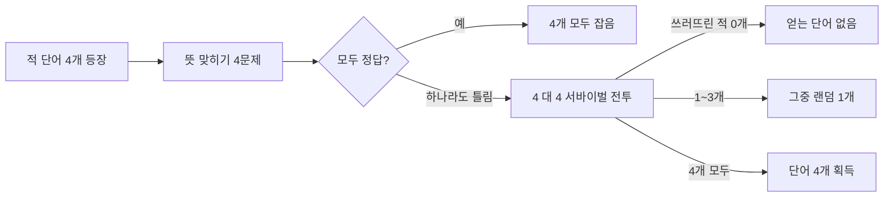
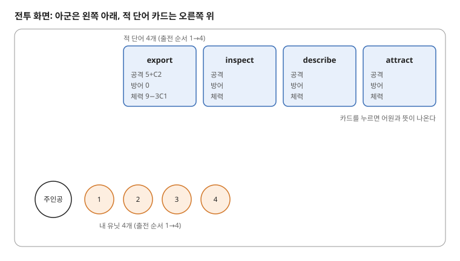

# 어원 RPG 설계

1차 단어 5,328개를 뜻 맞히기와 4 대 4 서바이벌 전투(마을에서는 미니게임)로 잡는 포켓몬스터형 RPG다. 잡은 단어는 두 개씩 합쳐 2\~4차로 진화시켜 유닛 12종의 장비로 입히고, 단어에서 얻은 어근은 유닛에 끼워 스킬로 쓴다. 주인공은 접두사 마법 14개(순서 2·효과 2·방어 6·공격 4)로 돕는다. 속성·진화·장비의 자세한 규칙은 [RPG 2차 설계](02-rpg-v2.md)에 있다.

## 개요

어근은 유닛의 스킬이고, 접두사는 주인공의 마법이다. 유닛은 장착한 어근에 따라 서로 다른 스킬을 조합과 상관없이 쓴다. 마법 14개는 순서 2개, 효과 2개, 방어 6개, 공격 4개로 나뉜다.

1. **수집:** 필드와 마을에 1차 단어 5,328개가 있다. 잡으면 단어 도감에 등록되고 그 단어의 어원을 얻는다. 2\~4차 4,662개는 진화로만, 보스 10개는 보스를 이겨야 얻는다.
2. **진화와 장비:** 속성을 공유하는 단어 2개를 합쳐 한 차수 위 단어를 만든다. 모든 단어는 정해진 유닛의 정해진 부위(무기·머리·가슴·장갑·신발)에 입는 장비다. 차수는 능력치를, 속성은 특수 능력을 준다.
3. **속성:** 단어장의 의미 영역 20개가 곱 속성이다. 스테이지 1에 1개로 시작해 스테이지 6에 20개가 모두 열린다. 적의 행동·능력치·특수 능력도 속성을 따른다.
4. **어근(스킬):** 얻은 어원 중 선정된 65개 어근만 유닛이 장착할 수 있다. 장착은 전투 준비 때만 하고, 전투마다 하나를 골라 스킬로 쓴다. 단어 장비와는 별개다. 나머지 2,600여 개는 도감 수집용이다.
5. **유닛 12종:** 능력 계열 12개가 곱 유닛 12종이다. 유닛은 자기 계열의 어근만 낄 수 있다.
6. **마법(접두사):** 주인공이 쓴다. 보스 1\~6을 이길 때 2개씩 얻는다.
7. **필드:** 일부 마법과 어근은 탐험에도 쓴다(덤불 베기, 숨은 길 보기 등). 필드와 마을에서는 장착하지 않는다. 그 어근(어원)을 갖고 있기만 하면 필드 능력을 쓸 수 있다. 필드 능력도 어원 뜻을 그대로 따른다.

## 시작과 이야기

주인공은 공방 마을에서 마법 de-와 어근 fac를 가지고 시작한다. fac가 있으므로 만들기 유닛이 처음부터 함께한다.

- **발단:** 공방 마을의 물건에서 결함 defect가 발견된다. defect는 de-(떨어져) + fac(만들다), 즉 "잘못 만들어진 것"이다. 시작할 때 가진 두 가지가 첫 단어를 이룬다.
- **여행의 이유:** 결함이 왜 생겼는지 찾아 10개 스테이지를 돈다.
- **첫 보스:** 공방 마을의 보스는 destroyer(de- + struct, 파괴자)다. 결함을 퍼뜨린 존재로 이야기를 잇는다.
- **최종 보스:** devil(악마)이다.

## 주인공

남자아이와 여자아이를 선택할 수 있다.

남자아이는 사용할 수 있는 유닛들이 팽귄이다.

여자아이는 사용할 수 있는 유닛들이 병아리다.

기능은 차이가 없으며 외모의 차이만 있다.

## 필드와 지역

필드는 스테이지 10개로 나뉜다. 스테이지마다 장소가 있고, 장소는 능력 계열(어근)을 따른다. 예를 들어 항구 도시에는 port·fer 같은 나르기·주기 단어가 많다. 속성은 장소와 별개로, 스테이지가 오를수록 늘어난다. 보스를 이기면 다음 스테이지가 열리고, 스테이지 10 갈라진 탑의 보스가 최종 보스 devil이다.

| # | 스테이지(가제) | 장소 계열 | 보스 | 보스가 주는 마법 | 필드 단어 | 마을 단어 | 새로 열리는 속성 |
| --- | --- | --- | --- | --- | --- | --- | --- |
| 1 | 공방 마을 | 만들기 | destroyer (파괴자) | re-, com- | 122 | 31 | 파동 |
| 2 | 사냥꾼 초원 | 잡기 | predator (포식자) | ad-, ob- | 461 | 115 | 권위·번영·생명 |
| 3 | 망루 도서관 | 보기 + 알기·가려내기 | wizard (마법사) | prae-, in- | 481 | 120 | 형상·영감·일상·시간 |
| 4 | 바람 협곡 | 가기·오기 | hurricane (허리케인) | pro-, ex- | 498 | 125 | 심판·지혜·질서·창조 |
| 5 | 항구 도시 | 나르기·주기 | pirate (해적) | in-(아닌), un- | 514 | 128 | 영혼·유대·바람·자연 |
| 6 | 왕성 | 말하기·쓰기 + 이끌기·다스리기 | dictator (독재자) | dis-, inter- | 481 | 120 | 공간·파멸·원소·신성 |
| 7 | 소용돌이 호수 | 돌리기·바꾸기 | vortex (소용돌이) | — | 426 | 107 | — |
| 8 | 성벽 요새 | 끌기·밀기·던지기 + 서기·두기·지키기 | guardian (수호자) | — | 426 | 107 | — |
| 9 | 부서진 광산 | 깨기·자르기 | dragon (용) | — | 426 | 107 | — |
| 10 | 갈라진 탑 | (모든 계열) | devil (최종 보스) | — | 426 | 107 | — |

보스 단어 10개(최종 보스 devil 포함)는 필드에 나오지 않고 진화도 하지 않는다. 보스를 이겨야 도감에 들어온다. 1차 설계의 specter·tyrant·titan은 지역을 합치면서 보스에서 빠져 보통 단어가 되었다.

스테이지는 번호 순서(1→10)로 한 곳씩 열린다. 장소 이름은 가제다. 12지역을 합친 방법은 이렇다: 망루 언덕 + 도서관 탑 → 망루 도서관, 서기의 신전 + 왕성 → 왕성, 투석 요새 + 성벽 요새 → 성벽 요새. 갈라진 탑은 새로 넣었다. 이유는 [2차 설계](02-rpg-v2.md)의 '스테이지 10개'에 있다.

### 보스 전투

- **팀:** 부하 3개가 앞에 서고, 보스 단어가 4번에 선다. 보스를 만나려면 부하 3개를 뚫어야 한다.
- **부하:** 그 스테이지 1차 단어에서 진화하는 2\~3차 단어다. 잡을 수는 없지만 도감에 "본 적 있음"으로 남아, 진화하면 어떤 단어가 되는지 미리 보여 준다.
- **퀴즈 없음:** 보스 전투에는 조우 퀴즈가 없다. 반드시 싸워야 한다.
- **전용 능력:** 보스는 일반 적에게 없는 능력을 갖는다("보스 능력 1차" 표).
- **패배:** 져도 잃는 것 없이 다시 도전할 수 있다.

**보스에게 가는 길:** 보스가 있는 곳까지 가는 길에는 그 스테이지 단어들이 몰려 있다. 그 스테이지 1차 단어(필드 + 마을)를 50% 넘게 얻지 못하면, 길의 적이 너무 많아 피해서 지나갈 수 없다. 단어를 잡을수록 길의 적이 줄고, 50%를 넘으면 피해 갈 틈이 생긴다. 예: 공방 마을은 122 + 31 = 153개 중 77개. 진화에 재료로 쓴 단어도 '얻은 단어'로 센다.

**보스 보상:** 보스를 이기면 그 스테이지 1차 단어 중 아직 못 얻은 것을 모두 준다. 1차 단어는 스테이지 하나에만 나오므로, 스테이지를 떠나도 놓치는 단어가 없다. 보스 1\~6은 여기에 더해 마법을 2개씩 준다. 그래서 왕성(스테이지 6)까지 깨면 마법 14개를 모두 갖는다.

> &#91;의견\] 보상으로 받은 단어는 퀴즈를 거치지 않아 학습이 빠진다. 대신 진화할 때 그 단어의 뜻을 맞혀야 하므로 결국 한 번은 풀게 된다. 후보 3가지: ① 남은 단어 모두 ② 남은 단어의 절반 ③ 보상 없음(재방문해서 잡기) → ①. 이전 규칙 '놓치는 단어 없음'을 지키고, 학습은 진화 퀴즈가 맡는다.

### 마을과 특수 행위

단어는 미리 나눠 두었다. 1차 단어 5,328개 중 필드에서 싸워서 얻는 단어가 4,261개, 마을 미니게임으로 얻는 단어가 1,067개다. 2\~4차 단어는 마을에서 진화로 얻는다.

- **마을:** 스테이지마다 마을이 하나씩 있다. 그 스테이지에 들어가면 바로 마을에 갈 수 있다. 마을은 이야기 진행에 필요하다.
- **NPC:** NPC는 단어를 주지 않고, 특수 활동을 안내하고 이야기를 전한다. 마을마다 보스로 이어지는 이야기가 있고, 그 중간에 특수 활동을 하는 장면과 단어를 잡아야 할 이유를 주는 퀘스트가 몇 개 들어간다(예: 항구의 짐 목록에 적힌 port 단어 3개를 잡아 오기).
- **특수 활동:** 마을마다 미니게임이 하나 있다. 마을 단어는 이 미니게임으로만 얻는다. 마을마다 약 107\~128개다(공방 마을만 31개).
- **한 판에 여러 개:** 미니게임 한 판에 단어를 여러 개 얻는다. 미니게임을 잘할수록 많이 얻는다(예: 낚시에 성공한 횟수만큼).
- **단어 시험:** 판이 끝나면 얻은 단어마다 뜻 문제가 나온다(4지선다). 맞힌 단어는 갖고, 틀린 단어는 놓친다. 놓친 단어는 다음 판에 다시 나올 수 있다.
- **횟수:** 제한이 없다. 언제든 하고 싶을 때 할 수 있다.
- **마을 단어:** 그 스테이지 1차 단어 중 장소 어근과 맞지 않는 흔한 단어(약 20%)이고, 필드에는 나오지 않는다. 얻으면 도감에 등록되고 그 단어의 어원을 얻는다.
- **진화:** 진화는 마을에서만 한다. 마을마다 진화하는 곳이 하나 있다(공방 마을은 대장간처럼 마을 분위기에 맞춘다). 어느 마을에서나 모든 단어를 진화할 수 있다(가정). 진화 퀴즈와 실패 규칙은 [2차 설계](02-rpg-v2.md)에 있다.
- **상점:** 상점, 회복약, 아이템은 없다.

| 마을 | 특수 행위 | 단어를 얻는 모습 |
| --- | --- | --- |
| 1 공방 마을 | 대장간 제작 | 물건을 만들면 그 물건의 단어가 나온다 |
| 2 사냥꾼 초원 | 덛 놓기 | 덛에 단어가 걸린다 |
| 3 망루 도서관 | 책 읽기 | 책 속 문장에서 단어를 골라낸다 |
| 4 바람 협곡 | 연날리기 | 바람에 날아다니는 단어를 연으로 낚아챈다 |
| 5 항구 도시 | 낚시 | 물에서 단어를 낚는다 |
| 6 왕성 | 필사 | 왕의 서기실에서 단어를 따라 쓴다 |
| 7 소용돌이 호수 | 물레방아 | 수문을 열어 물레방아 활로 몰려오는 단어 병사를 막는다 |
| 8 성벽 요새 | 보초 서기 | 성문을 지나는 단어를 검문한다 |
| 9 부서진 광산 | 광석 캐기 | 광석을 깨면 안에서 단어가 나온다 |
| 10 갈라진 탑 | 문양 잇기 | 갈라진 문양 조각을 이으면 갇혀 있던 단어가 풀려난다 |

미니게임에서 나오는 단어는 그 마을에 배정된 단어 중 아직 못 얻은 것에서 고른다.

### 미니게임 규칙 1차

미니게임은 간단한 퍼즐이다. 널리 알려진 퍼즐의 규칙을 빌려 와 마을 주제에 맞게 조합했다. 퍼즐 규칙만 빌리고, 특정 게임의 이름이나 그림은 쓰지 않는다. 한 판은 퍼즐 하나(1\~2분)이고, 잘할수록 단어를 많이 얻는다(한 판 최대 5개). 판이 끝나면 얻은 단어마다 뜻 4지선다를 풀고, 맞힌 단어만 갖는다.

| 마을 | 미니게임 | 빌려 온 퍼즐 | 규칙 | 단어를 얻는 법 |
| --- | --- | --- | --- | --- |
| 1 공방 마을 | 대장간 제작(주문 제작) | 주문 처리(오버쿡드 시리즈) + 깨진 조각 맞추기 | 고리 벨트를 도는 깨진 단어 조각(같은 색, 맞물리는 톱니)을 캐릭터가 옮겨 용광로에 넣고 모루에서 두드린다. 완성 단어를 맞는 뜻의 진열장에 올린다. 벨트 왼쪽은 창고에 가려 보이지 않는다 | 진열장에 맞게 올린 단어마다 1개. 3번 틀리면 끝 |
| 2 사냥꾼 초원 | 덫 놓기 | 지켜보고 덫 놓기(움직임 외워 길목에 덫 놓기) | 숨어서 단어 5개가 정해진 길로 도는 것을 지켜본다. 움직이면 단어들이 숨는다. 길목에 뜻이 적힌 덫을 놓고 다시 숨으면, 단어들이 똑같이 움직이다 뜻이 맞는 덫에 걸린다 | 잡은 단어마다 1개 |
| 3 망루 도서관 | 책 읽기 | 단어 찾기(글자 격자) | 알파벳 격자에서 숨은 영어 단어를 찾는다. 방향은 왼쪽→오른쪽, 위→아래, 왼쪽 위→오른쪽 아래만 있다. 뜻이 힌트로 나오고, 1분이 지나면 어원도 나온다. 10초마다 정답에 쓰이지 않는 글자가 하나씩 사라진다 | 찾은 단어마다 1개. 못 찾은 단어는 끝나고 판에 답을 보여 준다 |
| 4 바람 협곡 | 연날리기 | 파이프 잇기 | 7×7 바람길 타일을 돌려 연에서 하늘 끝까지 잇는다. 정답 길은 30칸 이상이고 그 위에 단어 5개가 있다. 단어 칸은 돌릴 때마다 뜻이 바뀌고, 맞는 뜻이 보이는 방향이 바른 길이다 | 단어 5개를 모두 맞는 뜻으로 지나 하늘에 닿으면 5개 |
| 5 항구 도시 | 낚시 | 찌 낚시 + 리듬 게임(위에서 본 물, 6방향 원 누르기) | 위에서 본 물. 뜻 미끼를 알고 찌를 던진다. 입질 원이 줄어들 때 손을 떼면 걸리고, 6방향 원을 리듬에 맞춰 누르면 잡힌다. 뜻이 맞으면 3번, 틀리면 6번 모두 맞혀야 한다 | 잡은 물고기마다 그 단어 1개. 놓치면 실수, 3번이면 끝 |
| 6 왕성 | 필사 | 애너그램(글자 섞기) | 얼음에 갇힌 글자 타일을 두드려 깨고 끌어서 바른 철자로 늘어놓는다. 뜻과 어원이 힌트다 | 맞힌 단어마다 1개 |
| 7 소용돌이 호수 | 물레방아(해자 지키기) | 타워 디펜스(물길을 나눠 물레방아 활 돌리기) | 수문을 열고 닫아 물레방아 3개의 활로 마을에 오는 단어 병사를 막는다. 하나만 열면 그 활이 빨라지고 셋을 열면 나눠 쏜다 | 100마리를 잡으면 이 판의 단어를 모두, 못 잡으면 절반 |
| 8 성벽 요새 | 보초 서기 | 막아서기 검문(뜻 판정 + 담 넘기 막기) | 성문 바깥에서 성문을 본다. 내 유닛을 좌우로 옮긴다. 성문으로 오는 손님의 단어와 뜻 팻말이 맞으면 비켜서 통과시키고, 틀리면 막아선다. 담 넘는 도둑·범죄자 단어는 뜻과 상관없이 막는다. 판정마다 보초 위에 결과가 뜬다 | 바르게 판정한 손님마다 1개. 틀린 판정이나 놓친 담 넘기는 실수, 3번이면 끝 |
| 9 부서진 광산 | 광석 캐기(광석 베기) | 그어 베기(프루트 닌자) + 어원 가리기 | 처음에 광맥 어원 2개를 알려 준다. 튀어 오르는 단어 광석 중 그 어원이 든 단어만 그어 깬다 | 맞게 깬 단어마다 1개. 다른 단어를 3번 깨면 끝 |
| 10 갈라진 탑 | 문양 잇기(갈라진 말뿌리 되찾기) | 새총·활 쏘아 맞히기 + 끌어 놓기(뿌리 되찾기) | 판에 단어 5개가 뜻과 함께 놓여 있다. 그 단어들의 어원과 함정 어원이 뜻을 달고 돌아다닌다. 화살로 쓰러뜨린 어원을 끌어 단어에 놓으면 그때 뿌리 선이 생긴다(어원 수는 미리 보이지 않는다) | 어원이 모두 맞게 자리 잡아 새싹이 오른 단어마다 1개. 새싹 5개면 완성. 시간이 다 되면 정답 어원을 보여 준다 |

&#91;의견\] 단어 찾기와 애너그램은 영어 철자를 직접 다루어서 학습 효과가 크다. 보초 서기는 처음에 "가짜 철자 골라내기"를 생각했지만, 없는 단어를 보여 주면 가짜를 외울 수 있어 어근 아이콘 정렬로 했다. 난이도는 스테이지와 상관없이 같다. 마을마다 퍼즐이 달라 새로움이 있으므로, 난이도까지 오르면 피로감이 커질 수 있다. 한 판 최대 5개면 마을 단어 약 110개를 모두 얻는 데 완벽하게 해도 22판이 필요하다.

&#91;의견\] 마을을 합친 세 곳은 미니게임을 하나씩만 남겼다.

- **망루 도서관:** 망원경 관측(다른 그림 찾기)과 책 읽기(단어 찾기) 중 책 읽기. 철자를 직접 찾아서 학습 효과가 크다.
- **왕성:** 필사(애너그램)와 연회(짝 맞추기) 중 필사. dictator(말하기·쓰기)의 이야기와 맞고 철자 학습이 된다. 다만 스테이지 3과 6이 모두 철자 퍼즐이 된다. (3차 피드백: 얼음 깨기와 끌어 놓기를 더함)
- **성벽 요새:** 과녕 맞히기(거울 반사)와 보초 서기(통 정렬) 중 보초 서기. guardian의 닫힌 성문 이야기와 이어지고, 어근 아이콘 정렬이 어원 학습이 된다. (구현 뒤 사용자 의견으로 바꿈: 통 정렬은 단어를 몰라도 풀려서 검문으로. 다시 사용자 의견으로 성문 앞에서 막아서는 방식으로 바꿈. [05-minigames.md](05-minigames.md))
- **갈라진 탑(새로):** 후보 ① 선 잇기 ② 조각 맞추기(직소) ③ 다리 잇기(다리 퍼즐) → ①. devil이 갈라놓은 것을 다시 잇는다는 이야기와 가장 잘 맞고, 규칙이 한 줄이다. (구현 뒤 바꿈: 같은 색 점 잇기는 단어와 상관없어서 단어와 갈라진 말뿌리 잇기로. [05-minigames.md](05-minigames.md))
- **바꾼 세 마을(블록 채우기·밀기 퍼즐·합치기 퍼즐 → 새 규칙):** 테트리스·15 퍼즐·2048은 너무 흔하고, 단어와 상관없이 풀 수 있어서 바꿨다. 새 규칙은 모두 단어의 뜻·어근·속성 무늬를 써야 풀린다. 마을 단어는 어원이 둘 이상인 단어가 20~27%뿐이라, 어원 조각을 나누는 퍼즐은 맞지 않는다. 모든 단어에 있는 뜻과 무늬를 쓰는 규칙으로 골랐다.
  - 공방 마을 후보: ① 주문 제작(오버쿡드식 주문 처리) ② 주형에 쇳물 붓기(물길 퍼즐) ③ 부품 기억 카드 → ①. 공방의 "주문받아 만든다"는 그림과 맞고, 시간 제한이 첫 마을에 손맛을 준다.
  - 소용돌이 호수 후보: ① 회전 고리(크립텍스) ② 리듬 맞춰 수문 열기 ③ 거울로 물빛 반사 → ①. vers(돌리다)를 손으로 돌리는 퍼즐이라 이 스테이지의 어근과 바로 이어진다.
  - 부서진 광산 후보: ① 광석 베기(프루트 닌자) ② 광맥 따라 굴착(길 찾기) ③ 무게 맞추기 저울 → ①. rupt(깨다)·cis(자르다)를 몸으로 하는 퍼즐이고, 다른 마을이 모두 생각하는 퍼즐이라 반사 신경을 쓰는 판이 하나 있으면 지루함이 줄어든다.

### 단어를 스테이지에 나누는 규칙

1차 단어 5,328개는 모두 스테이지 하나에만 나온다. 아래 순서로 정했다.

1. **열린 속성:** 단어의 속성(주·보조)이 모두 열린 스테이지부터 나올 수 있다. 예: 파동/권위 단어는 스테이지 2부터.
2. **장소 어근:** 그 뒤 스테이지 중 장소 계열 어근이 든 단어는 그 장소에 둔다. 예: defect는 공방 마을이 아니라, 속성이 열린 뒤 만나는 첫 만들기 장소에 둔다. 한 스테이지가 기준(약 533개)보다 15% 넘게 차면 다음으로 넘긴다.
3. **균형:** 나머지는 스테이지마다 수가 비슷해지게, 속성이 열린 스테이지에 가까운 쪽으로 나눈다.
4. **마을:** 스테이지마다 약 20%를, 장소 어근과 맞지 않는 흔한 단어로 골라 마을 단어로 둔다.

장소 어근이 든 단어는 스테이지 1부터 8, 15, 43, 75, 115, 155, 76, 224, 67개다(갈라진 탑은 없음). 2\~4차 4,662개는 진화로만, 보스 10개는 보스로만 얻는다. 단어별 차수·유닛·부위·트리·스테이지·얻는 방법은 CSV 파일(words\_v2\_plan.csv)로 만들었다.

> &#91;의견\] 스테이지 1·2는 열린 속성이 적어서, 공방 마을에 만들기 단어가 8개뿐이다. 장소 분위기를 살리려면 ① 장소 어근 단어는 속성 제한의 예외로 두기 ② 그대로 두고 마을 이야기로만 분위기 내기 ③ 스테이지 1의 속성을 만들기 단어가 많은 것(창조)으로 바꾸기가 있다. 지금은 ②로 두었다. 스테이지 1은 속성 연습보다 규칙 연습이 우선이라는 요청을 지키기 위해서다.

## 화면과 조작

2D 타일 맵 위를 걸어 다니는 게임이다. Godot로 만들고, 단어장 앱과는 따로 만든다. 단어 데이터는 단어장의 단어 JSON(default\_words.json)을 쓴다.

### 필드 화면

- 주인공은 타일 위를 걸어 다닌다.
- 적 단어는 필드에 보이고, 주변을 배회한다. 적 위에는 그 단어의 어근 계열 아이콘과 주속성 아이콘이 떠 있어, 필요한 어근과 속성을 골라 잡을 수 있다.
- 주인공이 시야에 들어가면 적이 쫓아온다. 피하려면 돌아가거나 멀어져야 한다.
- 속성마다 움직임이 다르다(예: 바람은 빠르게 쫓고, 공간은 순간이동한다). [2차 설계](02-rpg-v2.md)의 '적의 속성' 표를 따른다.
- 희귀 단어(1차 중 빈도 5인 단어)는 반대로 주인공을 보면 달아난다. ad- 마법의 필드 효과(다가가기)가 있으면 달아나지 못한다.
- 진화에 실패해 다시 잡아야 하는 단어(재포획 목표) 위에는 표식이 뜬다(가정).
- 적과 닿으면 전투 화면으로 넘어간다.

### 전투 화면

- 주인공과 내 유닛 4개는 왼쪽 아래, 적 단어 4개는 오른쪽 위에 있다.
- 적은 카드 형태다. 카드에는 단어, 공격·방어·체력, 주속성·보조속성 아이콘이 보인다.
- 아군 유닛에는 켜진 속성 능력(약·강) 아이콘이 보인다. 적 팀의 속성 묶음이 켜지면 적 쪽에도 보인다.
- 카드를 누르면 어원과 단어 뜻이 나온다. 단, 조우 퀴즈 중에는 뜻이 답이 되므로 퀴즈가 끝난 뒤에만 보여 준다(가정).
- 격돌 카드: 코인은 카드 바깥(위)에서 돌다가 앞면(H, 금색)·뒷면(T, 은색)으로 멈춘다. 카드 안에는 코인이 붙는 능력치 앞에 코인 표기를 쓴다. 표기 `+kCn`은 코인 n개 중 앞면 1개마다 +k라는 뜻이다(예: 공격 5에 `+2C3`이면 `공격 +2C3 5`). 코인이 011로 나오면 `공격 +2C3 9`가 된다. 코인 결과가 보이므로 수치를 셈할 수 있다.
- 카드를 누르고 있으면(전투 중에도) 누른 자리에 정보 창이 뜨고, 손을 떼면 사라진다. 적: 처음 능력치(코인 더하기 전, 체력 닳기 전), 뜻, 속성, 어원, 스킬과 설명, 보스 능력. 아군: 처음 능력치, 착용한 스킬과 설명. 옆 목록의 카드도 같다. 왼쪽 아래의 마법 카드를 누르고 있으면 이번에 쓴 마법의 설명이 뜬다.
- 연출 순서: 마법 알림 → 유닛 등장(카드는 코인 전 값으로 펴지고, 코인이 돈 뒤 바뀌는 능력치가 '전 → 후'로 깜빡인다. 시작 마법을 맞은 적은 그 효과도 깜빡인다) → 스킬·보스 능력(무엇이 발동했는지 알리고 바뀐 능력치를 깜빡인다) → 가운데에 '1턴' → 서로 공격(깎인 체력이 빨갛게 깜빡인다) → 둘 다 살아 있으면 '2턴' …
- 함께 등장: 잇달아 나오는 유닛(전투 처음엔 아군·적 둘 다, 둘이 함께 쓰러졌을 때도)은 동시에 나온다. 다 나온 다음 두 카드의 코인이 함께 약 1초 돌다가 앞뒤가 정해지고, 바뀌는 능력치도 함께 깜빡인다.
- 턴 수: 적이나 아군이 바뀌어도 1턴으로 돌아가지 않고 전투 처음부터 이어서 센다(1턴, 2턴, … 다음 적과 4턴, 5턴 …).
- 단계 진행: 단계마다 '다음 ▶'을 눌러야 넘어간다. 두 유닛이 나와 코인을 던짐 → 다음 → 전투 시작 마법(코인을 다 본 뒤에 알린다) → 다음 → 스킬·보스 능력(하나마다) → 다음 → 1턴 공격 → 다음 → 2턴 … 맞은 적 카드에서는 단어 뜻이 한쪽으로, 깎인 체력(-3)이 다른 쪽으로 튀어나와 2.6초 동안 보인다. 아군 카드에서는 깎인 체력만 튀어나온다.
- 부딪히기: 공격하는 턴에는 두 카드가 서로 기울며 다가가 가운데서 부딪힌다. 가운데 충격 이펙트가 터지고 두 카드가 흔들린다. 그때 깎인 체력이 빨갛게 깜빡이고 단어 뜻과 피해 숫자가 튀어나온다. 그 뒤 카드는 제자리로 돌아온다.
- 마법 연출(사용자 의견): 턴 앞에서 왼쪽 아래 마법(이번 전투의 3개)을 누르면 그 버튼 자리에서 마법 카드(접두사와 이름)가 유닛 카드처럼 돌며 커져 나온다. 공격 마법은 적 카드 위, 방어 마법은 아군 카드 위, 효과·순서 마법은 두 카드 가운데에 놓이고, 그 자리에서 마법마다 다른 이펙트가 터진 뒤 카드가 흐려진다. 이펙트 모양과 색은 `data/magic_fx.json`(뜻에 맞춰: de- 위에서 내리꽂는 화살, un- X자 긋기, in-(부정) 오그라드는 고리, ob- 되미는 충격파, com- 둥근 방패, re- 도는 화살표, ad- 모여드는 빛, sub- 밑에서 받치는 물결, prae- 앞으로 번쩍, inter- 가운데 벽, in- 빨려 드는 금빛, dis- 흩어지는 조각, ex- 갈라지는 화살표, pro- 앞으로 달리는 겹화살표). 그림 `fx/magic_<id>`가 있으면 그림을 쓴다.
- 등장: 유닛이 나올 때 카드는 옆 목록(아군은 왼쪽, 적은 오른쪽)의 작은 카드 자리에서 뱅그르르 한 바퀴 돌며 점점 커져 가운데 자리로 나온다.
- 쓰러짐: 체력이 0이 되는 그 턴에 바로(다음을 누르기 전) 카드가 밑을 축으로 상대 쪽(앞)으로 기울며 눕듯 납작해지고, 깜빡깜빡하다가 흐려져 사라진다. 그다음에 다음을 눌러 새 유닛이 나온다.
- 새 어근 기쁨: 전투에서 얻은 단어로 새 어근을 익혔으면, 결과 보기를 눌렀을 때 그 어근 계열의 유닛이 나와 통통 뛰며 기뻐하고(익힌 어근과 설명을 보여 준다) 그다음에 결과 화면이 나온다. 새 어근이 여러 유닛 것이면 유닛 번호 순으로 한 유닛씩 차례로 나온다. 아직 함께 다니지 않는 유닛은 나오지 않는다.
- 적 카드는 단어 카드와 같은 모양이다. 속성 색 바탕, 이름 앞 착용 부위 아이콘, 가진 단어는 남보라·처음 보는 단어는 주황 글자.
- 전투 기록: 전투 중에는 보이지 않는다. 결과 화면에서 얻은 단어와 뜻 아래에 보여 준다. 마법, 등장과 코인, 스킬(효과가 없었으면 '아무 변화가 없다'), 턴마다 피해와 체력, 쓰러짐을 남긴다. 턴(또는 새 격돌)마다 가로줄을 긋는다.

## 유닛 12종

유닛 하나가 능력 계열 하나다. 역할은 계열 뜻에서 나왔고, 장착 가능한 어근은 그 계열에 속한 것만이다.

| # | 유닛(계열) | 외모 | 전투 역할 | 어근 수 | 장착 가능한 어근 |
| --- | --- | --- | --- | --- | --- |
| 1 | 만들기 | 망치와 자를 갖고 있다. | 소환·보조: 분신, 벽, 아이템을 만든다 | 6 | fac, struct, form, par, nat, ple |
| 2 | 잡기 | 카우보이 모자와 밧줄을 들고 있다. | 도적: 빼앗고 붙든다 | 5 | cept, tain, pris, hib, quest |
| 3 | 보기 | 망원경을 들고 있다. | 정찰: 약점·은신을 드러낸다 | 3 | spect, vis, sens |
| 4 | 알기·가려내기 | 학자의 모습을 하고 있다. | 현자: 분석하고 고른다 | 5 | lect, cert, not, put, equ |
| 5 | 말하기·쓰기 | 마법사의 모습을 하고 있다. | 주술사: 선언·표식·규칙을 건다 | 5 | dict, script, sign, leg, jus |
| 6 | 가기·오기 | 쾌속 느낌의 날개를 달고 있다. | 질주: 속도·회피·자리 이동 | 7 | cess, ven, it, grad, curr, sequ, loc |
| 7 | 나르기·주기 | 천하장사 느낌을 준다. | 운반·회복: 힘과 효과를 주고받는다 | 7 | fer, port, miss, dit, pend, pay, grat |
| 8 | 이끌기·다스리기 | 지휘자의 느낌을 준다. | 지휘관: 동료를 강화하고 적을 조종한다 | 5 | duc, rect, act, cur, cap |
| 9 | 끌기·밀기·던지기 | 활과 갈고리를 갖고 있다. | 원거리: 끌어오고 밀어내고 던진다 | 5 | tract, press, ject, tend, pet |
| 10 | 돌리기·바꾸기 | 염력 초능력자 | 변환: 상태를 뒤집는다 | 4 | vers, turn, plic, mot |
| 11 | 서기·두기·지키기 | 큰 방패를 들고 있다. | 탱커: 버티고 막고 가둔다 | 8 | sta, pos, sid, clos, lig, strict, val, fort |
| 12 | 깨기·자르기 | 아주 큰 칼을 들고 있다. | 전사: 부수고 나눈다 | 5 | rupt, cis, cid, fin, part |

유닛의 능력치 식은 계열 역할에 맞춘다. 아래는 방향만 적은 것이고, 실제 식은 수치 검토 때 정한다.

| 유닛 | 역할 | 공격 | 방어 | 체력 | 코인 성향 |
| --- | --- | --- | --- | --- | --- |
| 1 만들기 | 소환·보조 | 보통 | 보통 | 보통 | 코인이 주로 스킬 조건에 쓰인다 |
| 2 잡기 | 도적 | 보통 | 낮음 | 보통 | 앞면이 많으면 빼앗기·붙들기 발동 |
| 3 보기 | 정찰 | 낮음 | 낮음 | 낮음 | 코인이 적고 스킬이 쉽게 발동 |
| 4 알기·가려내기 | 현자 | 낮음 | 보통 | 보통 | 고정값이 커서 안정적 |
| 5 말하기·쓰기 | 주술사 | 낮음 | 보통 | 낮음 | 코인이 주로 스킬 조건에 쓰인다 |
| 6 가기·오기 | 질주 | 보통 | 낮음 | 낮음 | 앞면이 많으면 공격이 크게 오른다 |
| 7 나르기·주기 | 운반·회복 | 보통 | 보통 | 높음 | 앞면이 많으면 체력이 오른다 |
| 8 이끌기·다스리기 | 지휘관 | 보통 | 보통 | 보통 | 코인이 동료 강화 스킬에 쓰인다 |
| 9 끌기·밀기·던지기 | 원거리 | 높음 | 낮음 | 낮음 | 공격 코인이 많다 |
| 10 돌리기·바꾸기 | 변환 | 보통 | 보통 | 보통 | 뒷면이 나와야 좋은 식이 있다 |
| 11 서기·두기·지키기 | 탱커 | 낮음 | 높음 | 높음 | 코인이 적고 안정적 |
| 12 깨기·자르기 | 전사 | 높음 | 보통 | 보통 | 공격 코인이 많고 변동이 크다 |

유닛의 어근 슬롯 수는 그 계열의 어근 수와 같다(만들기 6, 잡기 5 …). 어근을 얻을 때마다 슬롯이 채워진다. 전투에서는 슬롯의 어근 중 하나를 골라 장착하며, 유닛의 스킬과 방어 마법 퀴즈는 이 장착 어근으로 정해진다. 조합이 적은 나머지 어근(log, graph, manus 등)은 마법으로 살리지 않고 도감 수집용으로 둔다.

어근 장착은 단어 장비 5칸(무기·머리·가슴·장갑·신발)과 별개다. 어근은 스킬을, 장비는 능력치와 속성 능력을 정한다. 새로 얻은 장비는 그 유닛의 빈칸에만 자동으로 입혀지고, 바꾸기는 직접 한다. 해금되지 않은 유닛의 장비도 얻을 수 있고, 합류하면 바로 입힌다.

유닛은 그 계열의 어근을 처음 얻을 때 해금되어 합류한다. 어근은 그 어근이 든 단어를 잡거나 진화로 얻으면 얻는다. 지금 배정에서 유닛이 합류하는 스테이지는 만들기·알기 1, 잡기 2, 보기 3, 가기·돌리기 4, 나르기·말하기 5, 이끌기 6, 끌기·서기 8, 깨기 9다. 전투에 나가는 4개는 해금된 유닛 중에서 랜덤으로 뽑힌다. 해금된 유닛이 4개보다 적으면 적도 그 수만큼만 나오고, 조우 퀴즈도 그 수만큼 낸다(1 대 1, 2 대 2 …).

> &#91;의견\] 1차 설계에서는 지역마다 한 유닛씩 합류했지만, 이제는 속성 제한 때문에 끌기·서기(8)와 깨기(9)가 늦다. 이 유닛들의 장비는 일찍 모이지만 입을 주인이 없다. 앞당기려면 그 계열 어근이 든 단어 하나를 앞 스테이지 퀘스트 보상으로 주는 방법이 있다(예: 항구에서 project를 받아 끌기 합류).

어근은 라틴어 원형 대신 현대 영어에서 쓰이는 형태로 부른다(예: portare → port, capere → cept). 데이터의 modernEnglishForms 중 대표 형태 하나만 쓰고, 두 어근이 같은 이름이 되지 않게 골랐다.

## 어근 65개의 특수능력

전투 특수능력은 그 어근을 장착한 유닛의 스킬이다. 격돌을 시작할 때 던진 코인이 스킬의 조건을 채우면 발동한다(조건은 수치 검토 때 정한다). 표의 "이번 턴"은 "이번 격돌"로 읽는다. 장착은 전투 준비 때만 한다. 필드 능력은 장착과 상관없이, 그 어근을 갖고 있으면(그 어근이 든 단어를 하나라도 얻었으면) 필드와 마을에서 쓸 수 있다. 장면에서는 그 계열 유닛이 나서서 능력을 쓰는 모습으로 보여 준다. "실제 조합" 열의 단어는 방어 마법 퀴즈의 정답 후보다. 능력은 모두 어근 뜻에서 직접 나왔다.

### 1. 만들기

| 어근 | 뜻 | 전투 특수능력 | 필드 능력 | 실제 조합 |
| --- | --- | --- | --- | --- |
| fac | 만들다, 하다 | 이번 전투에 건 마법을 한 번 더 발동한다 (조건: 어려움) | 망가진 장치를 만들어 고쳐 길을 연다 | effect, affect, profit, defect |
| struct | 짓다, 쌓다 | 이번 격돌과 다음 격돌 동안 받는 피해 −2 (조건: 보통) | 끊긴 길에 다리·계단을 놓는다 | construct, instruct, destroy |
| form | 모양, 틀 | 적 스킬을 복사해 이번 격돌에 쓴다(조건 없이 발동) (조건: 어려움) | 변장해서 경비를 지나간다 | inform, reform, conform |
| par | 준비하다 | 다음 동료가 격돌을 시작할 때 코인 1개를 다시 던질 수 있다 (조건: 보통) | 장치를 미리 준비해 퍼즐을 푼다 | prepare, repair, apparel |
| nat | 태어나다 | 쓰러진 동료 1명을 체력 절반으로 대기열 맨 뒤에 되살린다 (조건: 어려움) | 단어 알을 부화시켜 희귀 단어를 얻는다 | innate, renaissance, international |
| ple | 채우다 | 체력 +3 (조건: 쉬움) | 빈 그릇·우물을 채워 퍼즐을 푼다 | supply, comply, implement |

### 2. 잡기

| 어근 | 뜻 | 전투 특수능력 | 필드 능력 | 실제 조합 |
| --- | --- | --- | --- | --- |
| cept | 잡다, 취하다 | 적의 강화 하나를 빼앗는다. 강화가 없으면 공격 +2 (조건: 보통) | — | accept, except, concept, intercept |
| tain | 붙들다, 유지하다 | 적은 첫 라운드에 공격하지 못한다 (조건: 보통) | 무거운 문을 붙들어 열어 둔다 | contain, retain, sustain, detain |
| pris | 움켜쥐다 | 적 스킬이 발동하면 그 스킬을 빼앗아 대신 쓴다 (조건: 어려움) | 난간을 잡고 높은 곳에 오른다 | comprise, enterprise, apprentice |
| hib | 가지다, 쥐다 | 이 전투가 끝날 때까지 지금 적의 스킬을 봉인한다 (조건: 어려움) | NPC에게서 얻는 단어를 하나 더 갖는다 | prohibit, disable, enable, exhibit |
| quest | 찾다, 구하다 | 이 유닛이 적을 쓰러뜨리면, 일부만 이긴 보상을 직접 고른다 (조건: 쉬움) | 근처의 희귀 단어를 탐지한다 | require, acquire, inquire, conquer |

### 3. 보기

| 어근 | 뜻 | 전투 특수능력 | 필드 능력 | 실제 조합 |
| --- | --- | --- | --- | --- |
| spect | 바라보다 | 이번 격돌 공격 +2 (조건: 보통) | 멀리 있는 지역을 내다본다 | inspect, respect, expect, suspect |
| vis | 보다 | 적의 코인 결과를 보고 내 코인 1개를 다시 던진다 (조건: 보통) | 숨은 길과 숨은 단어가 보인다 | provide, review, evident, invisible |
| sens | 느끼다 | 적의 첫 라운드 공격을 피한다 (조건: 보통) | 근처의 함정을 감지한다 | consent, resent, dissent |

### 4. 알기·가려내기

| 어근 | 뜻 | 전투 특수능력 | 필드 능력 | 실제 조합 |
| --- | --- | --- | --- | --- |
| lect | 모으다, 고르다, 읽다 | 다음에 나오는 적의 앞면 코인 1개를 뒷면으로 바꾼다 (조건: 보통) | 비석·책을 읽어 단서를 얻는다 | collect, elect, intellect |
| cert | 가려내다, 정하다 | 적 방어 −2 (조건: 쉬움) | 진짜 길과 가짜 길을 구별한다 | discern, concern, decree |
| not | 알게 되다 | 도감에 없는 적이면 공격 +2 (조건: 쉬움) | NPC의 알아듣기 힘든 말을 이해한다 | recognize, cognitive, acquaintance |
| put | 셈하다 | 적 체력이 절반 이하면 공격 +3 (조건: 쉬움) | 그 지역에서 모은 단어 수를 세어 보여 준다(count) | count, account, dispute |
| equ | 같은, 고른 | 격돌 시작 때 내 체력과 적 체력을 둘의 평균으로 맞춘다 (조건: 어려움) | 저울 퍼즐을 푼다 | adequate, unequal, inequality |

### 5. 말하기·쓰기

| 어근 | 뜻 | 전투 특수능력 | 필드 능력 | 실제 조합 |
| --- | --- | --- | --- | --- |
| dict | 말하다 | 적의 코인을 모두 뒷면으로 정한다 (조건: 어려움) | NPC를 설득한다 | predict, indicate, dedicate |
| script | 쓰다 | 이 전투에 건 마법을 다음 전투 시작 때 한 번 더 건다 (조건: 보통) | 본 단어를 일지에 적어 도감에 "본 적 있음"으로 남긴다 | describe, subscribe, prescribe |
| sign | 표시 | 지금 적에게 표식: 이 전투 내내 그 적이 받는 피해 +1 (조건: 쉬움) | 지도에 표시해 빠른 이동 지점을 만든다 | design, assign, resign |
| leg | 법 | 이 전투 동안 양쪽 모두 스킬로 회복할 수 없다 (조건: 쉬움) | — | colleague, delegation, illegal |
| jus | 법, 올바름 | 이번 격돌에서 받은 피해의 절반을 되돌려 준다 (조건: 보통) | 재판 이벤트에서 판결을 내린다 | adjust, prejudice, unjust |

### 6. 가기·오기

| 어근 | 뜻 | 전투 특수능력 | 필드 능력 | 실제 조합 |
| --- | --- | --- | --- | --- |
| cess | 가다, 물러서다 | 체력이 절반 이하가 되면 물러서며 체력 +4, 그 라운드 피해 무효 (조건: 보통) | 막힌 구역에 들어간다(access) | proceed, succeed, exceed, access |
| ven | 오다 | 도감의 단어 하나가 와서 적에게 피해 2 (조건: 쉬움) | 단어를 불러 모은다(만남↑) | prevent, invent, event, advent |
| it | 가다 | 격돌 시작 때 지나치며 적에게 피해 2 (조건: 쉬움) | 던전 출구를 대략 알려 준다(exit) | exit, initial, sudden |
| grad | 걸음, 단계 | 격돌에서 이길 때마다 이 전투 동안 공격 +1(누적) (조건: 쉬움) | 높은 층·계단을 오른다 | progress, degree, aggressive |
| curr | 달리다 | 첫 라운드에 두 번 공격한다 (조건: 보통) | 달리기(이동 속도↑) | occur, recur, incur, excursion |
| sequ | 뒤따르다 | 앞 동료를 쓰러뜨린 적과 싸우면 공격 +3 (조건: 쉬움) | 도망간 단어의 발자국을 따라간다 | pursue, execute, consecutive |
| loc | 장소 | 다음 동료가 나설 때 체력 +3(자리를 잡아 둔다) (조건: 쉬움) | 순간 이동 지점을 놓는다 | allocate, relocate |

### 7. 나르기·주기

| 어근 | 뜻 | 전투 특수능력 | 필드 능력 | 실제 조합 |
| --- | --- | --- | --- | --- |
| fer | 나르다, 지니다 | 이번 격돌에서 받은 강화를 다음 동료에게 넘긴다 (조건: 쉬움) | 무거운 짐을 나른다 | refer, offer, prefer, suffer |
| port | 나르다 | 자기에게 걸린 약화를 모두 적에게 옮긴다 (조건: 쉬움) | 항구에서 짐을 날라 주고 NPC에게서 단어를 얻는다 | export, import, support, report |
| miss | 보내다, 놓아주다 | 격돌에서 이기면 다음 적에게 피해 2를 보낸다 (조건: 보통) | 편지를 보내 NPC를 부른다 | dismiss, admit, submit, emit |
| dit | 주다 | 격돌이 끝날 때 남은 체력의 절반을 다음 동료에게 준다 (조건: 쉬움) | NPC에게 아는 단어를 알려 주고 새 단어를 받는다 | add, edit, render |
| pend | 달다, 치르다 | 체력 3을 치르고 이번 격돌 공격 +6 (조건: 보통) | 밧줄에 매달려 건너간다 | spend, depend, suspend, compensate |
| pay | 평화, 달래다 | 첫 라운드에는 양쪽 모두 공격하지 않고, 이 유닛이 체력 +4 (조건: 쉬움) | 화난 NPC를 달램다 | appease, repay |
| grat | 기쁘게 하는, 고마운 | 대기 중인 동료 모두 체력 +2 (조건: 보통) | 도와준 NPC가 보답한다 | agree, congratulate, disgrace |

### 8. 이끌기·다스리기

| 어근 | 뜻 | 전투 특수능력 | 필드 능력 | 실제 조합 |
| --- | --- | --- | --- | --- |
| duc | 이끌다 | 이 전투 동안 아군 전체 공격 +1 (조건: 어려움) | 미로에서 출구 방향으로 이끈다 | produce, conduct, reduce, educate |
| rect | 다스리다, 곧게 하다 | 자기에게 걸린 약화를 모두 풀고 공격 +1 (조건: 쉬움) | 휘어 있는 길을 곧게 해 지름길을 낸다 | direct, correct, erect |
| act | 하다, 몰다 | 대기 중인 동료 하나의 스킬을 이번 격돌에 쓴다(조건 없이) (조건: 어려움) | 단어 떼를 몰아 한곳에 모은다 | react, interact, enact |
| cur | 돌봄 | 다음 동료가 받는 첫 피해를 막는다 (조건: 쉬움) | 다친 NPC를 돌봐 주고 단어를 얻는다 | accurate, ensure, proxy |
| cap | 머리 | 이 유닛이 살아 있는 동안 아군 전체 방어 +1 (조건: 보통) | 단어 무리의 우두머리를 찾아낸다 | achieve, recap |

### 9. 끌기·밀기·던지기

| 어근 | 뜻 | 전투 특수능력 | 필드 능력 | 실제 조합 |
| --- | --- | --- | --- | --- |
| tract | 끌다 | 적의 앞면 코인 1개를 뒷면으로 끌어낸다 (조건: 보통) | 멀리 있는 물건을 끌어온다 | attract, extract, contract, distract |
| press | 누르다 | 이번 격돌 적 공격 −2 (조건: 보통) | 발판을 눌러 장치를 움직인다 | express, impress, suppress |
| ject | 던지다 | 대기 중인 적 하나에게 피해 3 (조건: 쉬움) | 물건을 던져 멀리 있는 스위치를 맞힌다 | project, reject, inject, object |
| tend | 뻗다, 늘이다 | 이번 격돌의 마지막 공격이 다음 적에게도 같은 피해를 준다 (조건: 보통) | 손이 안 닿는 곳의 물건을 집는다 | extend, attend, intend, pretend |
| pet | 노리다 | 적의 피하기 스킬(sens 등)을 무시하고 공격 +1 (조건: 쉬움) | 과녕 맞히기 퍼즐을 푼다 | compete, repeat, appetite |

### 10. 돌리기·바꾸기

| 어근 | 뜻 | 전투 특수능력 | 필드 능력 | 실제 조합 |
| --- | --- | --- | --- | --- |
| vers | 돌리다 | 이번 격돌 적의 공격과 방어를 맞바꾼다 (조건: 어려움) | 돌려서 여는 장치를 돌린다 | convert, reverse, divert, inverse |
| turn | 돌리다(바퀴처럼) | 이번 격돌에서 처음 받은 피해를 되돌린다 (조건: 보통) | 막힌 길의 우회로를 찾는다(detour) | return, detour, contour |
| plic | 접다, 펼치다 | 받은 피해만큼 다음 라운드 공격이 오른다 (조건: 보통) | 접힌 지도를 펼쳐 숨은 지역을 드러낸다 | reply, complicate, deploy, display, apply, imply |
| mot | 움직이다 | 이번 격돌에서 먼저 공격한다(같이 쓰러지지 않는다) (조건: 보통) | 바위를 밀어 옮긴다 | remove, promote, emotion |

### 11. 서기·두기·지키기

| 어근 | 뜻 | 전투 특수능력 | 필드 능력 | 실제 조합 |
| --- | --- | --- | --- | --- |
| sta | 서다 | 쓰러질 피해를 받으면 체력 1로 한 번 버틴다 (조건: 보통) | 거센 바람·물살 속에서도 서서 지나간다 | resist, insist, assist, exist |
| pos | 놓다, 두다 | 다음에 나오는 적이 격돌을 시작할 때 피해 3 (조건: 쉬움) | 덫을 놓아 단어 포획을 돕는다 | compose, oppose, deposit, propose |
| sid | 앉다 | 첫 라운드에 공격하지 않고 체력 +5 (조건: 쉬움) | 앉아서 기다리면 배회하는 적이 지나간다 | reside, president, assess |
| clos | 닫다 | 이번 격돌 동안 적 스킬을 봉인한다 (조건: 보통) | 문을 닫아 쫓아오는 적을 막는다 | include, exclude, conclude |
| lig | 묶다 | 받는 피해의 절반을 다음 동료가 대신 받는다 (조건: 보통) | 밧줄로 묶어 건너갈 길을 만든다 | rely, ally, obligation |
| strict | 조이다 | 다음에 나오는 적 2개는 스킬을 쓰지 못한다 (조건: 어려움) | 헐거운 장치를 조여 고친다 | restrict, constraint, district |
| val | 힘이 있다, 가치 있다 | 도감 단어 1,000개마다 공격 +1 (조건: 쉬움) | 단어의 희귀도(빈도)를 알아본다 | prevail, evaluate, avail |
| fort | 강한 | 이번 격돌 방어 +2 (조건: 쉬움) | 무거운 물건을 들어 옮긴다 | effort, enforce, comfort |

### 12. 깨기·자르기

| 어근 | 뜻 | 전투 특수능력 | 필드 능력 | 실제 조합 |
| --- | --- | --- | --- | --- |
| rupt | 깨다 | 적 방어를 0으로 만든다 (조건: 보통) | 금 간 벽을 부순다 | interrupt, disrupt, corrupt, eruption |
| cis | 자르다 | 적의 현재 체력을 반으로 자른다 (조건: 어려움) | 덤불·덩굴을 베어 길을 튼다 | decide, precise, concise |
| cid | 떨어지다 | 적을 바로 쓰러뜨린다(보스는 체력 절반) (조건: 어려움) | 높이 달린 열매·물건을 떨어뜨린다 | accident, incident, occasion, decay |
| fin | 끝, 경계 | 적 체력이 3 이하이면 바로 쓰러뜨린다 (조건: 쉬움) | 지역 경계를 넘어 다음 지역을 연다 | define, refine, infinite, confine |
| part | 부분, 몫 | 공격의 절반을 대기 중인 적 전체에 나눠 준다 (조건: 보통) | 파티를 둘로 나눠 갈림길을 동시에 살핀다 | depart, apart, proportion |

## 주인공 마법 14개 (접두사)

마법은 접두사 뜻 그대로 작동한다. 14개는 순서 마법 2개, 효과 마법 2개, 방어 마법 6개, 공격 마법 4개로 나뉜다. 필드 효과가 있는 마법은 탐험에도 쓴다.

### 마법 쓰기 (사용자 의견으로 바꿈)

- 유닛 창에서 가진 전투 마법 중 **4개를 덱으로 장착**한다(07-fun 2절, 사용자 의견: 덱을 짜는 즐거움). 전투마다 그 4개 중 **무작위 3개**(`offer_count`)가 나온다. 전투 준비에서 이번 전투의 마법을 보여 주고, 덱이 비었으면(스테이지 1) 전투 준비 없이 바로 전투가 시작된다.
- 유닛 어근도 유닛 창에서 미리 장착한다. 전투 준비의 어근 고르기 단계는 없앴다(07-fun 2절).
- **턴마다** 공격 앞에서 왼쪽 아래 마법 중 하나를 눌러 쓸 수 있다. 안 쓰면 '다음'. **한 전투에서 쓴 마법은 다시 못 고른다.** 그래서 한 전투에 쓸 수 있는 마법은 많아야 3개다.
- 마법은 지금 싸우는 두 유닛에게 걸린다. 마법을 건 다음 '다음'을 누르면 그 턴의 공격이 나온다. 마법으로 적이 쓰러지거나 순서가 바뀌면 그 턴은 공격 없이 다음 유닛이 나온다.
- 방어 마법은 걸기 전에 조합 뜻 고르기를 한다. 아군 장착 어근과 조합 단어가 없으면 고를 수 없다(이번 전투에 나오지도 않는다).
- 엔진(`BattleEngine`)은 턴 앞에서 멈추고(`begin`, `turn(마법)`), 화면이 고른 마법을 넘긴다. 이어 하기는 같은 씨앗과 같은 선택(`picks`)으로 같은 전투를 다시 계산한다.

> [의견] 지금 싸우는 유닛에게 걸도록 바꾼 마법: in- = 지금 아군의 뒷면 코인을 75%로 다시 던지고 남은 전투 내내 그 확률, ex- = 지금 싸우는 아군·적을 둘 다 맨 뒤로(지나친 유닛마다 체력 +, 다시 나와도 체력 유지), sub- = 기다리는 아군이 체력의 절반씩을 지금 아군에게, de- = 지금 적에게 피해와 공격 −. 후보 ① 지금 두 유닛 ② 언제나 1번 ③ 고를 때 대상도 고른다 → ①(턴마다 고르니 지금 싸움에 쓰는 것이 자연스럽고, 대상 고르기 단계가 늘지 않는다).

> **필드 마법과 전투 마법은 따로 관리한다.** 아래 표의 필드 효과(필드 마법 14개)는 이야기와 묶여 있어 고정이다. 전투 효과와 수치는 `data/balance/battle_magic.json`에서 정하고 레벨 테스트하며 고친다. 전투 마법은 더 늘어날 수 있지만 필드 마법은 늘리지 않는다. 이 절의 전투 효과·수치는 처음 잡은 값이고, 기준은 데이터 파일이다. 자세한 기준은 [03-tuning.md](03-tuning.md).

### 마법 얻기

**전투 마법(사용자 의견으로 바꿈):** 스테이지 1에는 전투 마법이 없다. 스테이지 1 보스를 이겨 스테이지 2가 열리면 종류마다 하나씩 4개(de- 공격, sub- 방어, in- 효과, ex- 순서)를 얻는다. 나머지는 스테이지 3(re-, com-, ad-, ob-), 4(prae-, in-(아닌), un-), 5(dis-, inter-, pro-)에서 얻는다(`battle_magic.json`의 `unlock.stage`, [의견] 동작을 만들 때 다시 본다). 아래 표는 **필드 마법**을 얻는 곳이다(이야기와 묶여 그대로).

de-는 처음부터 갖고, sub-는 공방 마을 이야기 보상으로 얻는다. 나머지 12개는 보스 1\~6을 이길 때 2개씩 얻는다. 지역과 마법은 뜻이 맞는 것끼리 짝지었다.

| 얻는 곳 | 마법 | 이유 |
| --- | --- | --- |
| 시작 | de-(공격) | defect의 de- |
| 공방 마을 이야기 | sub-(방어) | 마을 사람들이 떠받쳐 준다 |
| 1 공방 마을 (destroyer) | re-(방어), com-(방어) | 부서진 것을 다시, 함께 고친다 |
| 2 사냥꾼 초원 (predator) | ad-(방어), ob-(공격) | 사냥감에게 다가가 맞선다 |
| 3 망루 언덕 (specter) | prae-(방어), in-(효과) | 미리 내다보고 안을 꾰뚫는다 |
| 4 도서관 탑 (wizard) | in-(아닌)(공격), un-(공격) | 주문을 막고 되돌린다 |
| 5 서기의 신전 (dictator) | dis-(효과), inter-(방어) | 독재자의 힘을 떼어 놓고 사이에 벽을 세운다 |
| 6 바람 협곡 (hurricane) | pro-(순서), ex-(순서) | 바람을 뚫고 앞으로, 밖으로 나간다 |

### 순서 마법

순서 마법은 적과 아군의 순서에만 영향을 준다. 이 마법은 조합에 의한 효과를 줄 수 없으므로 효과를 추가한다. 순서를 옮기면서 지나친 유닛 개수만큼 뒤로가면 체력이 증가, 앞으로 가면 공격력이 증가한다.

| 마법 | 뜻 | 옮기는 방법 | 대상 | 덧붙는 효과 | 필드 효과 |
| --- | --- | --- | --- | --- | --- |
| ex- | 밖으로 | 아군 1번과 적 1번을 4번으로 옮긴다 | 양쪽 1번 | 둘 다 유닛 3개를 지나쳐 뒤로 가므로 체력이 3개분 오른다 | 던전 밖으로 빠져나온다 |
| pro- | 앞으로 | 지정된 유닛을 가장 앞으로 옮긴다 | 적·아군 관계없이 하나 | 지나친 유닛 수만큼 공격력이 오른다 | 앞길을 비춘다(어두운 동굴) |

예: pro-로 아군 3번을 맨 앞으로 옮기면 유닛 2개를 지나치므로 공격력이 2개분 오른다. 유닛 1개를 지날 때 오르는 양은 수치 검토 때 정한다.

### 효과 마법

| 마법 | 뜻 | 전투 효과 | 대상 | 필드 효과 |
| --- | --- | --- | --- | --- |
| in- | 안으로 | 선택한 유닛의 코인이 앞이 나올 확률을 높인다 | 적·아군 관계없이 하나 | 잠긴 건물 안으로 들어간다 |
| dis- | 따로 | 적 하나의 무기를 적에게서 따로 두게 하여, 그 적의 공격력을 0으로 한다 | 적 하나 | 묶인 것(사슬, 덩굴)을 풀어 흩는다 |

순서 마법과 효과 마법은 퀴즈나 저항 없이 바로 걸린다(가정).

### 공격 마법 4개

공격 마법은 항상 공격을 진행한다. 다만 그 접두사가 든 적 단어는 피해를 덜 받는다(예: describe는 de- 공격에 약하게 맞는다). 덜 받는 것은 피해만이고, 덧붙은 효과는 그대로 받는다(가정).

| 마법 | 뜻 | 전투 효과 | 필드 효과 | 피해를 덜 받는 단어 (/10,000) |
| --- | --- | --- | --- | --- |
| de- | 아래로, 떨어져 | 적 1번을 내리쳐 피해를 주고, 그 적의 공격을 전투 내내 끌어내린다 | 절벽 아래로 내려간다 | 157 (1.6%) |
| un- | 되돌림, 아닌 | 적 4개 모두에게 피해를 주고, 각 적이 처음 쓰는 스킬을 되돌려 없던 일로 만든다 | 잠긴 것을 연다(unlock) | 135 (1.4%) |
| in- (아닌) | 아닌, 없는 | 적 1번에게 피해를 주고, 그 적은 스킬을 쓰지 못한다(침묵) | 잠시 보이지 않게 된다 | 120 (1.2%) |
| ob- | 맞서 | 적 1번에게 피해를 주고, 첫 격돌에서 아군이 받는 피해의 일부를 되받아친다 | 길을 막는 것에 맞서 밀어낸다 | 52 (0.5%) |

피해를 덜 받는 단어는 드물다. 적 4개 중 하나라도 섞일 확률은 가장 많은 de-도 약 6%다. 더 자주 보이게 하려면 지역별로 그 접두사 단어를 많이 내보내면 된다.

### 방어 마법 6개

방어 마법은 기본적으로 아군 4개 모두에게 걸린다. 단, 발동할 때 아래의 "조합 뜻 고르기"를 통과해야 한다.

| 마법 | 뜻 | 전투 효과 (아군 4개) | 필드 효과 | 조합 어근 (/65) | 퀴즈가 나올 확률 |
| --- | --- | --- | --- | --- | --- |
| com- | 함께 | 전투 내내 싸우는 아군이 받는 피해를 대기 중인 동료가 함께 나눠 받는다 | 파티가 함께 큰 장애물을 옮긴다 | 44 | 99% |
| re- | 다시 | 아군이 격돌에서 이길 때마다 HP를 조금 되찾는다 | 마지막 마을로 돌아간다 | 41 | 99% |
| ad- | \~에, 더하여 | 아군 4개 모두에게 보호막을 더한다 보호막은 방어력을 1 더해준것과 같은 효과이다. | 보이는 단어에게 다가간다(달아나지 못함) | 39 | 98% |
| sub- | 아래에서 받쳐 | 아군 4개의 HP를 아군 1에게 몰아준다(수치 설계 뒤: 2\~4번이 체력의 절반씩을 1번에게 보태고, 1번이 쓰러져도 나머지는 싸운다. 이유는 "마법 수치 1차"의 \[의견\]). \[의견\] 변경, HP1을 계속 남기는 것은 너무 사기적인 스킬이 됨 | 몰래 걷는다: 단어와 덜 마주친다 | 21 | 78% |
| prae- | 미리 | 격돌마다 아군이 먼저 공격한다. 먼저 쓰러뜨리면 같이 쓰러지지 않는다 | 다음 지역에 사는 단어를 미리 본다 | 17 | 69% |
| inter- | 사이에 | 아군과 적 사이에 벽이 서서 첫 두 번의 격돌 동안 받는 피해가 줄어든다 | 두 지점 사이를 잇는 길을 찾는다 | 14 | 63% |

퀴즈가 나올 확률은 유닛 4개와 장착 어근을 랜덤으로 골랐을 때, 그 마법으로 만들어지는 단어가 1개 이상일 확률이다.

### 방어 마법 퀴즈: 조합 뜻 고르기

보기 5개는 영어 단어가 아니라 한국어 뜻이다. 영어 단어를 보기로 내면 모양이 다른 하나만 찾아도 풀려 너무 쉽다. 또 오답용으로 없는 단어를 만들면 학습자가 그 가짜 단어를 외우게 된다.

1. 아군 4개의 장착 어근마다 (접두사 + 어근)이 실제 단어가 되는지 본다. 되면 그 단어 1개를 정답으로 뽑는다. 접두사와 어근만으로 된 가장 흔한 단어를 우선한다.
2. 정답 수 N은 조합되는 유닛 수(1\~4개)다. 보기 5개는 정답 단어 N개의 뜻과 임의 단어 (5−N)개의 뜻이다. 조합되는 어근이 3개면 조합 뜻 3개와 임의 뜻 2개가 나온다.
3. 임의 뜻도 실제 단어의 뜻이며, 아무 단어에서 고른다. 없는 단어는 만들지 않는다.
4. 뜻을 고르면 그 아래에 해당 영어 단어가 뜬다. 이번 조합으로 만든 단어는 초록색, 임의 단어는 빨간색이다.
5. 정답 뜻을 모두 고르고 빨간색이 하나도 없으면 성공이다. 성공하면 아군 4개 모두 효과를 받는다. 색만 보고도 성공인지 바로 알 수 있다.
6. 몇 개를 골라야 하는지는 화면에 알려 준다. 고른 뜻은 되돌릴 수 없고, 빨간색이 뜨면 그 자리에서 실패다. 실패하면 마법만 쓰이고 효과는 없다(가정).
7. 만들어지는 단어가 0개면 그 마법은 이번 전투에서 고를 수 없다(가정).
8. 초록색으로 확인된 단어는 잡지 않아도 도감에 "본 적 있음"으로 남는다.

예: 아군의 장착 어근이 port, spect, pos, duc이고 sub-를 건다. duc는 sub-와 만드는 단어가 없으므로 정답은 3개다. 보기는 「지지하다」 「의심하다」 「생각하다」 「결정하다」 「용감한」 5개다. 앞의 셋을 고르면 support, suspect, suppose가 초록색으로 뜬다. 결정하다를 고르면 decide가 빨간색으로 뜨고 실패한다.

## 조우와 전투

### 조우: 뜻 맞히기

적은 서로 다른 단어 4개로 나온다. 싸우기 전에 4개 단어의 뜻을 맞히는 문제가 나온다. 단어마다 4지선다다.

- 4개를 모두 맞히면 싸우지 않고 4개를 모두 잡는다.
- [사용자 의견] 맞힌 단어는 싸우지 않고 잡는다. 틀린 단어만 전투에 들어간다(맞힐 까닭이 있게). 예전에는 하나라도 틀리면 4개 모두와 싸웠다.
- 보스 전투에는 뜻 맞히기 단계가 없다(바로 전투 준비).

### 전투: 4 대 4 서바이벌

- 내 유닛 12종 중 4개가 랜덤으로 뽑혀 나선다. 적 4개의 출전 순서는 랜덤으로 정해진다.
- **전투 준비:** 전투가 시작되기 전에 쓸 마법 1개와 유닛마다 쓸 어근(스킬)을 고른다. 두 단계로 나뉜다. ① 마법 고르기 → **다음** → ② 어근 고르기 → **전투 시작**(이전으로 돌아갈 수 있다). 적 카드 4장과 출전 순서는 원래 자리(오른쪽 위)에 그대로 보이고, 고르는 판은 화면 오른쪽 아래 절반에 오른쪽 정렬로 놓이고, 아군 유닛은 왼쪽에 보인다. 마법이나 어근을 **누르면 고르고 그 설명이 바로 나온다**(설명은 밸런스 데이터의 실제 수치로 채운다). 전투 중에는 바꾸지 않는다.
- **마법 발동:** 전투가 시작되면 고른 마법이 먼저 발동한다. 방어 마법은 이때 퀴즈를 거친다.
- **격돌:** 이어서 유닛들이 출전 순서대로 싸운다. 적 1번과 아군 1번이 격돌하면 둘이 같이 코인을 던지고, 그 결과로 공격력·체력이 정해진다. 그다음 둘이 동시에 (공격력 − 상대 방어력)만큼 피해를 주고받기를 한쪽이 쓰러질 때까지 반복한다. 코인은 격돌을 시작할 때만 던진다. 피해는 최소 1이다(가정).
- **서바이벌:** 이긴 유닛은 남은 HP 그대로 다음 적과 싸운다. 아군 1번이 이기면 아군 1번과 적 2번이 격돌하고, 이때는 새로 나온 적 2번만 코인을 던진다. 살아남은 쪽은 앞 코인 결과를 그대로 쓴다. 적이 이겨도 같다.
- 둘 다 쓰러지지 않을 수 있다. 그러면 양쪽 모두 다시 공격한다.
- 둘이 같이 쓰러질 수 있다. 그러면 양쪽 모두 다음 유닛이 나와 둘 다 코인을 던진다.
- **출전 순서:** 바꿀 수 없다. 단, 순서 마법을 써서 순서를 변경할 수 있다.
- 한쪽 4개가 모두 쓰러지면 끝난다. 단판 승부다.

전투 방식은 카드 게임 「판타지 마스터즈」의 룰을 차용했다.

적은 스킬을 랜덤하게 쓴다. 적 전용 스킬도 있고, 아군 스킬 중 적이 못 쓰는 것도 있다.

### 유닛 능력치와 코인

코인 개수, 공격력, 방어력, 체력, 그리고 코인에 따른 공격력·체력의 변화는 유닛마다 정한다. 값은 나중에 정한다.

- **Cn = 코인 n개의 앞면 수.** 앞에 붙은 수를 곱해 더한다. 예: +2C3은 코인 3개 중 앞면 수 × 2를 더한다.
- **코인은 한 번만 던진다.** 유닛의 식에서 가장 큰 n만큼 코인을 던져 앞·뒤를 정한다. 코인은 최대 5개다(n ≤ 5).
- **각 식은 앞에서부터 n개를 쓴다.** 공격력이 +2C3, 체력이 +3C2이면 코인 3개를 던진다. 공격력은 3개 모두의 앞면 수 × 2, 체력은 다시 던지지 않고 앞의 2개의 앞면 수 × 3을 더한다.

예: 유닛 A = 공격력 5+C2, 방어력 0, 체력 9−3C1. 코인은 2개다.

| 1번 코인 | 2번 코인 | 공격력 | 체력 |
| --- | --- | --- | --- |
| 앞 | 뒤 | 5+1 = 6 | 9−3 = 6 |
| 뒤 | 앞 | 5+1 = 6 | 9−0 = 9 |

**레벨과 코인:** 레벨이 오르면 능력치의 고정값이 오른다. 코인은 레벨 10 단위로 바뀐다. 코인 개수가 바뀌면 코인이 들어간 식도 함께 바뀐다. 코인은 최대 5개라, 레벨 50과 60에서는 개수 대신 코인 앞의 계수가 커진다.

예: 유닛 A의 단계별 식(숫자는 자리 표시).

| 레벨 | 코인 | 공격력 | 방어력 | 체력 |
| --- | --- | --- | --- | --- |
| 1\~9 | 1개 | 4+C1 | 0 | 9−2C1 |
| 10\~19 | 2개 | 5+C2 | 0 | 9−3C1 |
| 20\~29 | 3개 | 6+C3 | 1 | 10−3C1 |
| 30\~39 | 4개 | 7+C4 | 1 | 11−3C2 |
| 40\~49 | 5개 | 8+C5 | 1 | 12−3C2 |
| 50\~59 | 5개 | 9+2C5 | 2 | 13−3C2 |
| 60 | 5개 | 10+2C5 | 2 | 14−2C2 |

단계 사이의 레벨에서는 고정값이 조금씩 오른다. 위 표는 규칙을 보여 주는 예이고, 실제 식과 숫자는 "수치 설계 1차"에 있다.

**스킬 발동:** 스킬마다 코인 조건이 있다(쉬움·보통·어려움 3단계). 조건은 코인 개수에 맞춰 바뀐다. 격돌을 시작할 때 던진 코인이 조건을 채우면 그 격돌에서 스킬이 발동한다. 같은 코인이 능력치와 스킬을 함께 정한다.

**적 능력치:** 적 단어의 능력치 식은 빈도와 어근 계열로 정한다. 빈도가 낮을수록 강하고, 단어에 든 계열 어근의 성향(유닛 표의 공격·방어·체력 방향)을 따른다. 계열 어근이 없는 단어는 그 단어가 나온 지역의 계열을 따른다. 예: 성벽 요새의 드문 단어는 방어·체력이 높은 강한 적이다. 적의 코인 수는 지역 순서로 정한다.

### 보상

- 적 4개를 모두 쓰러뜨리면 단어 4개를 모두 얻는다. 마지막에 같이 쓰러져도 적 4개를 다 쓰러뜨렸으면 다 이긴 것으로 본다.
- 1\~3개만 쓰러뜨리면 쓰러뜨린 단어 중 랜덤으로 1개를 얻는다.
- 하나도 못 쓰러뜨리면 얻는 단어가 없다.

져도 보상만 없고 따로 잃는 것은 없다. 전투가 끝나면 유닛은 모두 회복하고 게임이 자동 저장된다. 저장은 전투가 끝날 때만 한다.

수치(공격력·방어력·체력 값, 스킬의 코인 조건)는 아직 정하지 않았다. 표의 숫자는 자리 표시다.

## 단어 수집과 성장

단어를 얻을 때마다 유닛이 경험치를 받는다. 유닛 레벨은 1\~60이고, 레벨이 오르면 그 유닛의 능력치 식이 좋아진다(예: 공격력 5+C2 → 6+C2). 단어 가족을 모으는 것 자체가 학습이 된다.

### 유닛 레벨과 경험치

- **모든 유닛이 받는다:** 단어를 얻으면 12종 유닛 모두가 경험치를 받는다(아직 해금되지 않은 유닛도). 그래서 늦게 합류한 유닛도 바로 쓸 수 있다.
- **계열 보너스:** 단어에 든 계열 어근의 유닛은 2배를 받는다. 계열 어근이 없는 단어는 모든 유닛이 기본만 받는다.
- **중복:** 같은 단어를 다시 얻으면 1/10만 받는다.
- **마을 단어와 보스 보상 단어**도 똑같이 경험치를 준다.

단어 하나의 기본 경험치는 **그 단어가 나오는 지역 번호 × 10**이다(공방 마을 10, 부서진 광산 120). 뒤 지역 단어일수록 값이 커서 레벨이 지역 순서에 맞춰 고르게 오른다. 레벨 L까지 필요한 누적 경험치는 **200 × L²**이다(레벨 60 = 720,000). 단어를 모두 처음 얻으면 기본만으로 약 레벨 59에 닿고, 계열 보너스와 중복으로 60을 채운다. 예상 레벨은 "수치 설계 1차"의 지역 표에 있다.

**재방문:** 보스를 깬 지역에도 언제든 다시 갈 수 있다. 다시 싸우거나 미니게임을 하면 중복 경험치를 얻는다.

- **희귀도:** 단어장의 빈도 레벨(1\~10)을 그대로 쓴다. 빈도 10은 어디서나 나오고, 빈도 1은 깊은 지역에만 나온다.
- **어근 해금:** 어근이 들어 있는 단어를 하나 얻으면(잡기·진화) 그 어근을 갖게 된다. 그때부터 전투 준비에서 장착할 수 있고, 필드 능력은 장착 없이 바로 쓸 수 있다. 같은 어근의 단어를 더 모으면 도감의 어근 가족이 채워진다(예: cept 단어 accept, except, concept…).
- **마법 해금:** 지역 보스를 이기면 그 지역의 마법을 얻는다(마법 절의 "마법 얻기" 표).
- **조합 도감:** 방어 마법 퀴즈에서 초록색으로 확인된 조합 단어는 잡지 않아도 "본 적 있음"으로 도감에 남는다. 잡으러 갈 목표가 생긴다.
- **지역:** 지역마다 특정 계열 어근의 단어가 많이 산다. 한 지역을 돌면 한 단어 가족을 연달아 만난다.
- **학습:** 조우의 뜻 맞히기와 방어 마법의 조합 뜻 고르기가 곧 단어장 앱의 시험이다. 앞은 뜻을, 뒤는 어원 조합을 익힌다.

**도감:** 얻은 단어는 도감에서 뜻·어원·예문을 볼 수 있다. 시험은 없다. 단어는 얻은 지역(지역 필드 또는 마을)별로 분류한다. 여러 지역에 나오는 단어는 처음 얻은 지역으로 분류한다(가정).

## 이야기와 퀘스트 1차

> 이 절은 12지역 기준이다. 10스테이지 기준 이야기는 [docs/story/00-overview.md](../story/00-overview.md)와 [장면 청사진](../story/blueprint.md)이 대신한다.

지역별 대사와 장면 연출은 [대사와 장면 1차(12지역 기준)](../story/dialogue-v1-12regions.md)에 있다. 10스테이지 기준 이야기는 [docs/story](../story/)에서 새로 쓴다.

### devil 이야기 (전체 줄기)

devil의 어원은 dia(가로질러) + ballein(던지다)이다. 원래 devil은 말을 이쪽에서 저쪽으로 "건너 던져" 전하던 왕의 전령이었다. 말을 비틀어 전하다 쓰러나자, 전하는 자에서 갈라놓는 자가 됐다. 이제 devil은 모든 단어를 어원에서 떼어내, 뜻 없는 소리로 만들려 한다. 어원을 잃은 단어는 결함(defect)을 일으키고 필드를 떠도는 적이 된다.

| 막 | 지역 | devil 이야기에서 일어나는 일 |
| --- | --- | --- |
| 1막 결함의 원인 | 1\~3 | 보스를 쓰러뜨릴 때마다 같은 "갈라진 문양"이 남는다. 누군가 보스들을 부리고 있다 |
| 2막 이름과 과거 | 4\~8 | 도서관 탑에서 문양의 이름 devil = dia + ballein을 풀어낸다. 왕성에서 devil이 왕의 전령이었다는 과거가 드러난다. 항구에서 배신자의 복선이 깔린다 |
| 3막 목적과 배신자 | 9\~11 | 소용돌이 호수에서 devil의 목적(모든 단어를 어원에서 떼어내기)을 안다. 성벽 요새에서 배신자를 파헤친다 |
| 4막 갈라짐과 이어짐 | 12\~최종 | 나르기·주기 유닛이 devil에게 간다. dragon을 넘어 devil과 싸운다. 이기면 단어와 어원이 다시 이어지고 배신한 유닛도 돌아온다 |

### 지역별 기승전결

| 지역 | 기 | 승 | 전 | 결 |
| --- | --- | --- | --- | --- |
| 1 공방 마을 | 주인공이 만든 물건에서 결함 defect가 나온다 | 대장장이에게 배우며 마을 곳곳의 결함을 고친다 | 결함은 누군가 일부러 낸 것이었다. destroyer가 공방을 부순다 | destroyer를 이기자 "갈라진 문양"이 남는다. 문양을 쫓아 여행을 떠난다 |
| 2 사냥꾼 초원 | 초원의 사냥감과 가축이 사라진다 | 사냥꾼과 덫을 놓고 우리를 다시 세운다 | predator가 단어들을 삼켜 몸집을 키운다 | predator에게도 같은 문양. 사냥꾼이 "망루에서 본 적이 있다"고 알려 준다 |
| 3 망루 언덕 | 안개에 덮여 망루가 아무것도 보지 못한다 | 망루지기와 관측하며 숨은 길을 찾는다 | specter가 안개 속에서 "그분이 오신다"고 속삭인다 | 안개가 걷히자 멀리 도서관 탑에 같은 문양의 깃발이 보인다 |
| 4 도서관 탑 | 책의 글자가 지워지고 있다 | 사서와 책을 읽으며 지워진 글자를 되살린다 | wizard가 문양의 이름이 적힌 책을 없애려 한다 | 책에서 이름 devil과 어원 dia + ballein(가로질러 던지다)을 찾는다 |
| 5 서기의 신전 | dictator가 말 한마디로 법을 바꾼다 | 서기와 원래 법전을 베껴 쓰며 복원한다 | dictator가 devil의 명령서를 갖고 있다 | 명령서에 "바람 협곡 너머에서 기다린다"고 적혀 있다 |
| 6 바람 협곡 | 폭풍에 협곡 길이 끊긴다 | 연 만드는 노인과 바람길을 읽고 절벽을 오른다 | hurricane이 협곡을 막고 일행을 날려 버린다 | 협곡을 넘어 항구에 닿는다. 나르기·주기 유닛이 "내 고향"이라며 반긴다 |
| 7 항구 도시 | 해적이 배와 짐을 빼앗는다 | 선원들과 낚시하고 짐을 나르며 마을을 돕는다 | pirate가 일행의 길을 미리 알고 기다리고 있다 | pirate를 이기지만 "누가 길을 알려 줬을까?"라는 의문이 남는다(복선) |
| 8 왕성 | tyrant가 왕을 몰아내고 성을 차지했다 | 연회에 숨어들어 귀족들을 하나씩 설득한다 | 쓰러진 왕이 devil은 원래 자신의 전령이었다고 고백한다 | tyrant를 이기고 왕이 돌아온다. devil의 과거가 드러난다 |
| 9 투석 요새 | 거인이 바위를 던져 요새를 부순다 | 궁수들과 과녁을 맞히며 성벽을 다시 잇는다 | titan이 "그분께 길을 넘겨받았다"고 말한다 | titan을 이기고 다음 길이 열린다. 누군가 길을 넘겨주고 있다는 의심이 커진다 |
| 10 소용돌이 호수 | 호수 물이 거꾸로 돈다 | 방앗간 주인과 물레방아를 고치고 수문을 돌린다 | vortex가 devil의 목적, 모든 단어를 어원에서 떼어내는 일을 말한다 | 호수가 바르게 돌고, 성벽 요새로 가는 배가 떠난다 |
| 11 성벽 요새 | 수호자가 성문을 닫아 아무도 들어가지 못한다 | 보초병과 보초를 서며 성 안에 들어갈 틈을 찾는다 | guardian을 이기자 "누군가 성문 암호를 넘겨주었다"는 진실을 듣는다 | 넘겨준 자를 파헤쳐, traitor = trans- + dare(주다)에서 나르기·주기 유닛을 알아낸다 |
| 12 부서진 광산 | 들킨 나르기·주기 유닛이 devil에게 달아난다 | 광부들과 광석을 캐고 막힌 갱도를 뚫는다 | 갱도 끝에서 dragon이 길을 막는다 | dragon을 넘자 devil의 거처가 나타난다 |
| 최종 | devil이 배신한 유닛과 함께 기다린다 | devil은 "전하는 자는 결국 갈라놓게 된다"고 말한다 | 배신한 유닛은 "고향 항구를 지켜 주겠다"는 약속에 속았다 | devil을 이기면 단어와 어원이 다시 이어지고, 유닛이 돌아온다 |

### 마을 퀘스트

마을마다 퀘스트는 세 가지다. 보스에게 가는 길은 세 퀘스트를 끝내고, 그 지역 단어를 50% 넘게 얻어 길의 적이 줄어야 지나갈 수 있다.

- **마법 퀘스트:** 이전까지 얻은 마법의 필드 효과로 푼다. NPC가 그 접두사의 뜻을 설명하고 예시 단어를 보여 주는 장면이 들어간다.
- **어근 스킬 퀘스트:** 그 지역 계열 어근의 필드 능력으로 푼다. 그 어근을 갖고 있으면 풀 수 있다(장착은 필요 없다).
- **단어 퀘스트:** 그 지역 필드 단어 3개를 잡아 온다. 퀘스트 단어는 필드에서 더 자주 나온다(가정).

| 지역 | 마법 퀘스트 (설명하는 접두사) | 어근 스킬 퀘스트 | 단어 퀘스트 |
| --- | --- | --- | --- |
| 1 공방 마을 | de-(아래로): 절벽 아래 재료 창고로 내려간다. 예: descend, decline | struct: 끊긴 길에 다리를 놓는다 | repair, instrument, implement |
| 2 사냥꾼 초원 | com-(함께): 마을 사람들과 함께 쓰러진 울타리를 옮긴다. 예: combine, company | tain: 우리의 무거운 문을 붙들어 열어 둔다 | capture, chase, prey |
| 3 망루 언덕 | ad-(\~쪽으로): 달아나는 희귀 단어에게 다가가 잡는다. 예: advance, adapt | vis: 안개 속 숨은 길을 찾는다 | visible, invisible, prospect |
| 4 도서관 탑 | in-(안으로): 잠긴 서고 안으로 들어간다. 예: include, inside | lect: 비석을 읽어 비밀 서가의 단서를 얻는다 | lesson, select, legend |
| 5 서기의 신전 | un-(되돌림): 봉인된 법전 상자를 연다. 예: unlock, undo | dict: 신전 경비를 말로 설득한다 | script, manuscript, prescription |
| 6 바람 협곡 | inter-(사이에): 두 절벽 사이를 잇는 길을 찾는다. 예: international, interval | grad: 절벽의 계단을 한 단계씩 오른다 | exit, sequence, procedure |
| 7 항구 도시 | pro-(앞으로): 꺼진 등대에서 배의 앞길을 비춘다. 예: progress, project | fer: 배에 무거운 짐을 나른다 | import, export, reporter |
| 8 왕성 | ex-(밖으로): 갇힌 왕을 성 밖으로 빼낸다. 예: exit, export | rect: 휘어 있는 미로를 곧게 해 지름길을 낸다 | regime, regulation, realm |
| 9 투석 요새 | ob-(맞서): 굴러오는 바위에 맞서 밀어낸다. 예: obstacle, oppose | tract: 성벽 위 밧줄을 끌어온다 | reject, trajectory, projection |
| 10 소용돌이 호수 | prae-(미리): 소용돌이가 다음에 어디로 갈지 미리 본다. 예: predict, prepare | vers: 돌려서 여는 수문을 돌린다 | reverse, conversion, controversy |
| 11 성벽 요새 | in-(아닌): 보이지 않게 되어 보초 몰래 지나간다. 예: invisible(in- + vis), impossible | lig: 무너진 성벽 사이를 밧줄로 묶어 건넌다 | ① stable, establish, assist ② 넘겨준 자 찾기: reliable, rely, alliance |
| 12 부서진 광산 | dis-(따로): 사슬로 묶인 광부들을 풀어 준다. 예: disconnect, dismiss | rupt: 금 간 벽을 부수고 막힌 갱도를 뚫는다 | corrupt, corruption, bankrupt |

&#91;의견\] 마법 퀘스트는 보스 1\~6이 주는 순서대로 가장 최근에 얻은 마법을 쓰도록 배치했다. 새 마법을 얻자마자 다음 마을에서 그 뜻을 배우는 흐름이다. 성벽 요새의 invisible은 in-(아닌)과 그 지역의 이웃 계열 어근 vis가 함께 든 단어라, 마법과 어근이 만나는 장면으로 쓸 수 있다.

guardian은 devil에게 속아 문을 잠근 수호자다. 이기면 진실을 알고 주인공을 돕는다. 끝까지 악당만 나오지 않게 하는 굴곡이다.

### 복선과 배신

devil(갈라놓는 자)에 맞게, 아군 유닛 하나가 배신한다. 배신하는 유닛은 **나르기·주기**다. 배신자 traitor의 어원 tradere(넘겨주다)는 trans-(건너) + dare(주다)이고, dare는 나르기·주기 유닛의 어근 dit이다. 어원이 곧 범인을 가리킨다.

1. **복선 (7 항구 도시):** 해적은 주인공 일행의 길을 늘 미리 알고 있다("누가 너희 길을 알려 줬을까?"). 항구 필드에는 traitor, treason, betray가 살고, 마을 낚시로는 tradition, trade를 얻는다. 선원 NPC는 "이 단어들은 모두 '넘겨주다'에서 왔지"라고 말한다. 나르기·주기 유닛은 이 항구가 고향이고, 가끔 혼자 사라지는 장면이 나온다.
2. **파헤치기 (11 성벽 요새):** guardian을 이기면 "누군가 성문 암호를 넘겨주었다"는 진실을 듣는다. 단어 퀘스트 "넘겨준 자 찾기": reliable, rely, alliance를 잡아 믿을 수 있는 자를 가린다. 끝에서 traitor = trans- + dare(주다)를 깨닫고, dare가 나르기·주기 유닛의 어근임을 알게 된다.
3. **배신 (12 부서진 광산):** 들킨 나르기·주기 유닛은 devil에게 달아난다. 부서진 광산과 최종전 동안 이 유닛은 아군으로 나오지 않는다(경험치는 계속 받는다).
4. **최종전:** devil 팀에 나르기·주기 유닛이 플레이어와 같은 레벨로 나온다. devil을 이기면 devil이 갈라놓았던 것이 다시 이어지며, 이 유닛도 돌아온다.

&#91;의견\] 배신자를 나르기·주기로 고른 것은 ① 돌리기·바꾸기("돌아서다", vers) ② 잡기("사로잡다") ③ 나르기·주기("넘겨주다", tradere = trans + dare) 중 ③만 실제 단어 traitor의 어원으로 증명되기 때문이다. 플레이어가 어원을 풀어 범인을 찾는 순간이 이 게임의 주제와 맞다. devil을 포함한 보스 단어는 필드에서 빼고, 보스를 이겨야 얻게 했다.

## 수치 설계 1차

> 이 절의 표와 승률은 12지역 때 시뮬레이션이다. 10스테이지 기준 결과는 [sim-10stage.md](sim-10stage.md)이고, 실제 값은 `data/balance/`가 기준이다.

목표 승률은 필드 전투 70\~80%다. 스킬 65개(적도 씀), 마법 14개, 보스 능력을 모두 넣은 통합 시뮬레이션에서, 그때까지 얻은 마법 중 하나를 골랐을 때 필드 승률은 평균 71\~83%, 가장 좋은 마법을 골랐을 때 81\~96%다. 보스는 평균 55\~79%, 최선 64\~93%다.

&#91;의견\] 시뮬레이션은 방어 마법 퀴즈 성공률을 80%로 두었고, 일부 스킬(form·act·lect 등)은 비슷한 수치로 줄여서 넣었다. 구현 뒤 실제 플레이 기록으로 한 번 더 맞추는 것을 권한다.

### 유닛 능력치 공식

> 10스테이지 시뮬레이션에서 레벨당 증가를 3배로 키우고 코인 값 k를 3 + L/20으로 바꿨다. 지금 값은 `data/balance/unit.json`이고 아래 표는 12지역 때 값이다([sim-10stage.md](sim-10stage.md) 2절).

능력치 = 기본값 + 레벨당 증가 × (레벨 − 1)(소수점 버림) + 코인 항. 코인 개수는 레벨 1\~9: 1개, 10\~19: 2개, 20\~29: 3개, 30\~39: 4개, 40 이상: 5개다. 코인 항의 계수 k는 레벨 49까지 3, 레벨 50부터 4다.

| 성향 | 공격 (기본 / 레벨당) | 방어 (기본 / 레벨당) | 체력 (기본 / 레벨당) |
| --- | --- | --- | --- |
| 낮음 | 2 / 0.09 | 0 / 0.018 | 6 / 0.24 |
| 보통 | 3 / 0.12 | 0 / 0.03 | 8 / 0.3 |
| 높음 | 4 / 0.15 | 1 / 0.048 | 11 / 0.42 |

코인 성향에 따른 코인 항(s = 코인 개수):

| 코인 성향 | 코인 항 | 쓰는 유닛 |
| --- | --- | --- |
| 공격 코인 | 공격 + k·Cs | 잡기, 가기·오기, 끌기·밀기·던지기 |
| 체력 코인 | 체력 + 2k·Cs | 나르기·주기 |
| 스킬 코인 | 공격 + k·C(s÷2), 남은 코인은 스킬 조건에 쓴다 | 만들기, 보기, 말하기·쓰기, 이끌기·다스리기 |
| 안정 | 공격 + k·C1 | 알기·가려내기, 서기·두기·지키기 |
| 뒷면 유리 | 공격 + k·(s − Cs) | 돌리기·바꾸기 |
| 변동 | 공격 + 2k·Cs, 체력 − k·C1 | 깨기·자르기 |

C(s÷2)에서 s÷2가 0이면 1로 본다.

### 만들기 유닛 (시작 유닛)

공격·방어·체력 모두 보통, 스킬 코인이다.

| 레벨 | 코인 | 공격력 | 방어력 | 체력 |
| --- | --- | --- | --- | --- |
| 1 | 1개 | 3+3C1 | 0 | 8 |
| 10 | 2개 | 4+3C1 | 0 | 10 |
| 20 | 3개 | 5+3C1 | 0 | 13 |
| 30 | 4개 | 6+3C2 | 0 | 16 |
| 40 | 5개 | 7+3C2 | 1 | 19 |
| 50 | 5개 | 8+4C2 | 1 | 22 |
| 60 | 5개 | 10+4C2 | 1 | 25 |

### 유닛 12종 능력치

위 공식에 유닛 표의 성향을 넣은 값이다. 칸은 공격 / 방어 / 체력 순서다. "뒷면n"은 코인 n개 중 뒷면 수다.

| 유닛 | 공격·방어·체력 | 코인 성향 | 레벨 1 | 레벨 30 | 레벨 60 |
| --- | --- | --- | --- | --- | --- |
| 1 만들기 | 보통·보통·보통 | 스킬 코인 | 3+3C1 / 0 / 8 | 6+3C2 / 0 / 16 | 10+4C2 / 1 / 25 |
| 2 잡기 | 보통·낮음·보통 | 공격 코인 | 3+3C1 / 0 / 8 | 6+3C4 / 0 / 16 | 10+4C5 / 1 / 25 |
| 3 보기 | 낮음·낮음·낮음 | 스킬 코인 | 2+3C1 / 0 / 6 | 4+3C2 / 0 / 12 | 7+4C2 / 1 / 20 |
| 4 알기·가려내기 | 낮음·보통·보통 | 안정 | 2+3C1 / 0 / 8 | 4+3C1 / 0 / 16 | 7+4C1 / 1 / 25 |
| 5 말하기·쓰기 | 낮음·보통·낮음 | 스킬 코인 | 2+3C1 / 0 / 6 | 4+3C2 / 0 / 12 | 7+4C2 / 1 / 20 |
| 6 가기·오기 | 보통·낮음·낮음 | 공격 코인 | 3+3C1 / 0 / 6 | 6+3C4 / 0 / 12 | 10+4C5 / 1 / 20 |
| 7 나르기·주기 | 보통·보통·높음 | 체력 코인 | 3 / 0 / 11+6C1 | 6 / 0 / 23+6C4 | 10 / 1 / 35+8C5 |
| 8 이끌기·다스리기 | 보통·보통·보통 | 스킬 코인 | 3+3C1 / 0 / 8 | 6+3C2 / 0 / 16 | 10+4C2 / 1 / 25 |
| 9 끌기·밀기·던지기 | 높음·낮음·낮음 | 공격 코인 | 4+3C1 / 0 / 6 | 8+3C4 / 0 / 12 | 12+4C5 / 1 / 20 |
| 10 돌리기·바꾸기 | 보통·보통·보통 | 뒷면 유리 | 3+3×뒷면1 / 0 / 8 | 6+3×뒷면4 / 0 / 16 | 10+4×뒷면5 / 1 / 25 |
| 11 서기·두기·지키기 | 낮음·높음·높음 | 안정 | 2+3C1 / 1 / 11 | 4+3C1 / 2 / 23 | 7+4C1 / 3 / 35 |
| 12 깨기·자르기 | 높음·보통·보통 | 변동 | 4+6C1 / 0 / 8−3C1 | 8+6C4 / 0 / 16−3C1 | 12+8C5 / 1 / 25−4C1 |

&#91;의견\] 방어는 거의 자라지 않는다(보통은 레벨 60에서도 1). 피해가 최소 1이라 방어가 커지면 탱커가 지나치게 강해지기 때문이다. 탱커의 방어만 더 키우고(예: 레벨 60에 5), 나머지는 지금처럼 두는 방향도 있다. 또 스킬 코인 유닛(보기·말하기·쓰기 등)은 능력치가 낮은 대신 스킬이 강해야 한다. 스킬을 넣은 시뮬레이션에서 이 유닛들의 승률을 따로 확인해야 한다.

### 스킬 코인 조건

스킬마다 조건 단계 하나를 정하고, 실제 조건은 그 유닛의 코인 개수(c)로 정해진다.

| 단계 | 조건 | 코인 1개 | 3개 | 5개 |
| --- | --- | --- | --- | --- |
| 쉬움 | 앞면 1개 이상 | 50% | 88% | 97% |
| 보통 | 앞면이 절반 이상(올림) | 50% | 50% | 50% |
| 어려움 | 모두 앞면 | 50% | 13% | 3% |

코인이 늘수록 쉬운 스킬은 자주, 어려운 스킬은 드물게 터진다. 어려운 스킬은 효과를 크게 잡는다.

### 지역별 난이도

적 레벨 = 지역 기준 레벨 + 빈도 보정(5 − 빈도, −2\~+3). 적의 능력치는 위 유닛 공식에 그 적의 계열 성향과 적 레벨을 넣되, 코인 개수는 지역 표를 따른다. 지역 기준 레벨은 그 지역에 들어올 때 플레이어의 예상 레벨보다 2 낮게 잡았다(왕성만 같게). 보스 레벨과 코인은 시뮬레이션으로 지역마다 맞췄다.

| 지역 | 적 기준 레벨 | 적 코인 | 보스 레벨 | 보스 코인 | 필드: 마법 없음 | 필드: 마법 평균 | 필드: 최선 마법 | 보스: 마법 평균 | 보스: 최선 마법 |
| --- | --- | --- | --- | --- | --- | --- | --- | --- | --- |
| 1 공방 마을 | 1 | 1 | 4 | 2 | 66% | 78% | 92% | 56% | 86% |
| 2 사냥꾼 초원 | 3 | 1 | 7 | 2 | 61% | 72% | 84% | 55% | 64% |
| 3 망루 언덕 | 7 | 1 | 10 | 1 | 65% | 71% | 81% | 57% | 66% |
| 4 도서관 탑 | 12 | 2 | 18 | 3 | 70% | 78% | 89% | 67% | 81% |
| 5 서기의 신전 | 17 | 2 | 23 | 3 | 69% | 83% | 96% | 76% | 92% |
| 6 바람 협곡 | 23 | 3 | 28 | 4 | 70% | 79% | 90% | 79% | 93% |
| 7 항구 도시 | 28 | 4 | 34 | 5 | 55% | 73% | 91% | 73% | 93% |
| 8 왕성 | 35 | 4 | 38 | 5 | 60% | 73% | 91% | 67% | 84% |
| 9 투석 요새 | 38 | 5 | 43 | 5 | 58% | 73% | 89% | 57% | 80% |
| 10 소용돌이 호수 | 42 | 5 | 47 | 5 | 60% | 74% | 88% | 73% | 90% |
| 11 성벽 요새 | 47 | 5 | 51 | 5 | 57% | 74% | 88% | 63% | 79% |
| 12 부서진 광산 | 52 | 5 | 58 | 5 | 63% | 73% | 87% | 60% | 82% |

승률은 적을 모두 쓰러뜨릴 확률이다. 필드는 플레이어가 지역에 들어온 레벨, 보스는 예상 레벨(3, 7, 11, 17, 22, 27, 33, 37, 42, 46, 51, 57)에서 쟰다. 지역 1\~3은 해금된 유닛 수에 맞춰 1 대 1\~3 대 3으로 돌렸다.

&#91;의견\] 통합 시뮬레이션 뒤 바꾼 것: ① 왕성은 다른 지역보다 쉬워서(85%) 적 기준 레벨을 2 올렸다. ② 망루 언덕 보스는 코인 2개일 때 42%여서 코인을 1개로 줄이고 레벨을 예상 레벨 −1로 낮췄다. ③ 사냥꾼 초원·성벽 요새 보스는 레벨을 예상 레벨과 같게 낮췄다.

### 스킬 수치 1차

어근 65개의 스킬 조건과 효과 수치다. 어근 표의 "전투 특수능력"과 다르면 이 표가 기준이다. 조건은 쉬움·보통·어려움 중에서 골랐고, 기준은 효과의 세기다. 작은 효과는 쉬움, 격돌 하나를 바꾸는 효과는 보통, 전투 전체를 바꾸거나 즉사·부활 같은 효과는 어려움이다. 효과는 모두 그 유닛의 격돌에서 일어난다.

| 어근 | 조건 | 효과 (1차 수치) | \[의견\] |
| --- | --- | --- | --- |
| fac | 어려움 | 이번 전투에 건 마법을 한 번 더 발동한다 | 마법은 전투에 1개뿐이라 2번은 크다. 보통이면 시작 유닛이 너무 세진다 |
| struct | 보통 | 이번 격돌과 다음 격돌 동안 받는 피해 −2 | 두 격돌에 걸쳐 남는 벽 |
| form | 어려움 | 적 스킬을 복사해 이번 격돌에 쓴다(조건 없이 발동) | 어떤 스킬이든 가져올 수 있어 강하다 |
| par | 보통 | 다음 동료가 격돌을 시작할 때 코인 1개를 다시 던질 수 있다 | 원래 "마법 두 번"이었으나 fac와 겹쳐서 "준비"로 바꿨다 |
| nat | 어려움 | 쓰러진 동료 1명을 체력 절반으로 대기열 맨 뒤에 되살린다 | 부활은 서바이벌 규칙을 크게 바꾼다 |
| ple | 쉬움 | 체력 +3 | 원래 "마법 게이지"는 없어져서 체력을 채우는 것으로 바꿨다 |
| cept | 보통 | 적의 강화 하나를 빼앗는다. 강화가 없으면 공격 +2 | 강화가 없을 때도 쓸모가 있게 |
| tain | 보통 | 적은 첫 라운드에 공격하지 못한다 | 2턴 붙들기는 서바이벌에서 너무 길다 |
| pris | 어려움 | 적 스킬이 발동하면 그 스킬을 빼앗아 대신 쓴다 | form보다 조건이 더 붙지만 적의 스킬까지 막는다 |
| hib | 어려움 | 이 전투가 끝날 때까지 지금 적의 스킬을 봉인한다 | 격돌 하나만 막는 clos와 차이를 두었다 |
| quest | 쉬움 | 이 유닛이 적을 쓰러뜨리면, 일부만 이긴 보상을 직접 고른다 | 전투 밖 효과라 승패에 영향이 작다 |
| spect | 보통 | 이번 격돌 공격 +2 | "약점 계열" 체계가 없어 단순 공격 증가로 바꿨다 |
| vis | 보통 | 적의 코인 결과를 보고 내 코인 1개를 다시 던진다 | 숨은 적·회피 체계가 없어 "보고 대응"으로 바꿨다 |
| sens | 보통 | 적의 첫 라운드 공격을 피한다 |  |
| lect | 보통 | 다음에 나오는 적의 앞면 코인 1개를 뒷면으로 바꾼다 | 출전 순서가 이미 공개돼서 "미리 보기" 대신 바꿨다 |
| cert | 쉬움 | 적 방어 −2 |  |
| not | 쉬움 | 도감에 없는 적이면 공격 +2 |  |
| put | 쉬움 | 적 체력이 절반 이하면 공격 +3 |  |
| equ | 어려움 | 격돌 시작 때 내 체력과 적 체력을 둘의 평균으로 맞춘다 | 체력이 큰 보스에게 특히 강하다 |
| dict | 어려움 | 적의 코인을 모두 뒷면으로 정한다 | 코인 5개 보스에게 결정적이다 |
| script | 보통 | 이 전투에 건 마법을 다음 전투 시작 때 한 번 더 건다 | 효과가 다음 전투로 미뤄져 fac보다 약하다 |
| sign | 쉬움 | 지금 적에게 표식: 이 전투 내내 그 적이 받는 피해 +1 |  |
| leg | 쉬움 | 이 전투 동안 양쪽 모두 스킬로 회복할 수 없다 | 회복하는 적에게만 듣는다 |
| jus | 보통 | 이번 격돌에서 받은 피해의 절반을 되돌려 준다 |  |
| cess | 보통 | 체력이 절반 이하가 되면 물러서며 체력 +4, 그 라운드 피해 무효 | "대기열 뒤로 교대"는 순서는 마법으로만 바꾼다는 규칙과 겹쳐 바꿨다 |
| ven | 쉬움 | 도감의 단어 하나가 와서 적에게 피해 2 |  |
| it | 쉬움 | 격돌 시작 때 지나치며 적에게 피해 2 | 순서 규칙 때문에 "다음 적 공격" 대신 바꿨다 |
| grad | 쉬움 | 격돌에서 이길 때마다 이 전투 동안 공격 +1(누적) |  |
| curr | 보통 | 첫 라운드에 두 번 공격한다 |  |
| sequ | 쉬움 | 앞 동료를 쓰러뜨린 적과 싸우면 공격 +3 |  |
| loc | 쉬움 | 다음 동료가 나설 때 체력 +3(자리를 잡아 둔다) | 순서 바꾸기를 뺀 대신 "장소"를 살렸다 |
| fer | 쉬움 | 이번 격돌에서 받은 강화를 다음 동료에게 넘긴다 |  |
| port | 쉬움 | 자기에게 걸린 약화를 모두 적에게 옮긴다 |  |
| miss | 보통 | 격돌에서 이기면 다음 적에게 피해 2를 보낸다 | "적을 대기열 뒤로"는 순서 규칙과 겹쳐 바꿨다 |
| dit | 쉬움 | 격돌이 끝날 때 남은 체력의 절반을 다음 동료에게 준다 |  |
| pend | 보통 | 체력 3을 치르고 이번 격돌 공격 +6 |  |
| pay | 쉬움 | 첫 라운드에는 양쪽 모두 공격하지 않고, 이 유닛이 체력 +4 |  |
| grat | 보통 | 대기 중인 동료 모두 체력 +2 |  |
| duc | 어려움 | 이 전투 동안 아군 전체 공격 +1 | 전투 전체에 걸리는 효과 |
| rect | 쉬움 | 자기에게 걸린 약화를 모두 풀고 공격 +1 | 1 대 1에서는 "공격 대상 정하기"가 의미가 없어 바꿨다 |
| act | 어려움 | 대기 중인 동료 하나의 스킬을 이번 격돌에 쓴다(조건 없이) |  |
| cur | 쉬움 | 다음 동료가 받는 첫 피해를 막는다 |  |
| cap | 보통 | 이 유닛이 살아 있는 동안 아군 전체 방어 +1 |  |
| tract | 보통 | 적의 앞면 코인 1개를 뒷면으로 끌어낸다 | "대기 중인 적 끌어오기"는 순서 규칙과 겹쳐 바꿨다 |
| press | 보통 | 이번 격돌 적 공격 −2 |  |
| ject | 쉬움 | 대기 중인 적 하나에게 피해 3 |  |
| tend | 보통 | 이번 격돌의 마지막 공격이 다음 적에게도 같은 피해를 준다 |  |
| pet | 쉬움 | 적의 피하기 스킬(sens 등)을 무시하고 공격 +1 |  |
| vers | 어려움 | 이번 격돌 적의 공격과 방어를 맞바꾼다 | 방어가 낮은 적은 공격이 거의 0이 된다 |
| turn | 보통 | 이번 격돌에서 처음 받은 피해를 되돌린다 |  |
| plic | 보통 | 받은 피해만큼 다음 라운드 공격이 오른다 |  |
| mot | 보통 | 이번 격돌에서 먼저 공격한다(같이 쓰러지지 않는다) | prae- 마법의 1인판이다 |
| sta | 보통 | 쓰러질 피해를 받으면 체력 1로 한 번 버틴다 |  |
| pos | 쉬움 | 다음에 나오는 적이 격돌을 시작할 때 피해 3 |  |
| sid | 쉬움 | 첫 라운드에 공격하지 않고 체력 +5 |  |
| clos | 보통 | 이번 격돌 동안 적 스킬을 봉인한다 | hib의 짧은 판 |
| lig | 보통 | 받는 피해의 절반을 다음 동료가 대신 받는다 |  |
| strict | 어려움 | 다음에 나오는 적 2개는 스킬을 쓰지 못한다 |  |
| val | 쉬움 | 도감 단어 1,000개마다 공격 +1 | 후반에 최대 +10 |
| fort | 쉬움 | 이번 격돌 방어 +2 |  |
| rupt | 보통 | 적 방어를 0으로 만든다 |  |
| cis | 어려움 | 적의 현재 체력을 반으로 자른다 |  |
| cid | 어려움 | 적을 바로 쓰러뜨린다(보스는 체력 절반) | "날고 있는 적"은 없어서 "사고(accident)"로만 남겼다 |
| fin | 쉬움 | 적 체력이 3 이하이면 바로 쓰러뜨린다 |  |
| part | 보통 | 공격의 절반을 대기 중인 적 전체에 나눠 준다 |  |

### 보스 능력 1차

보스마다 전용 능력을 하나씩 정했다. 보스 능력은 코인 조건 없이 항상 발동한다. 후보 3가지 중에서 골랐고, 후보와 이유를 \[의견\]에 적었다.

| 보스 | 능력 | \[의견\] 후보 3가지 → 고른 이유 |
| --- | --- | --- |
| 1 destroyer | 결함: 격돌마다 아군 코인 1개를 뒷면으로 고정한다 | ① 아군 방어 무시 ② 격돌마다 체력 회복 ③ 코인 결함 → ③. 초반 유닛은 방어가 0이라 ①은 의미가 없고, ③은 defect 이야기와 이어진다 |
| 2 predator | 포식: 아군을 쓰러뜨릴 때마다 체력 +3 | ① 체력 낮은 아군부터 끌어냄 ② 첨 라운드 2번 공격 ③ 포식 → ③. ①은 순서 규칙을 깨고, ③은 눈으로 보기 쉽다 |
| 3 specter | 투명: 격돌의 첫 라운드에는 피해를 받지 않는다 | ① 아군 코인 미리 보기 ② 스킬 봉인 ③ 투명 → ③. 유령답고, 승률이 높은 3지역을 적당히 어렵게 한다 |
| 4 wizard | 주문: 격돌 시작 때 공격 마법 하나를 랜덤으로 쓴다 | ① 아군 마법 무효 ② 코인 다시 던지기 ③ 랜덤 마법 → ③. 적도 마법을 쓴다는 것을 처음 보여 준다 |
| 5 dictator | 명령: 격돌마다 아군 코인 2개를 뒷면으로 정한다 | ① 아군 스킬 봉인 ② 출전 순서 바꾸기 ③ 코인 명령 → ③. dict(말하다)의 뜻과 맞고, 승률이 높은 5지역을 조이는 데 쓴다 |
| 6 hurricane | 폭풍: 격돌 시작 때 대기 중인 아군 전체에 피해 2 | ① 아군 순서 섞기 ② 코인 다시 던지기 ③ 폭풍 → ③. 바람이 모두를 치는 그림이 분명하다 |
| 7 pirate | 약탈: 아군이 건 방어 마법의 효과를 빼앗아 자기에게 건다 | ① 보상 단어 빼앗기 ② 공격 마법 무효 ③ 마법 약탈 → ③. ①은 "져도 잃는 것 없음" 규칙과 어긋난다. 마법을 다 갖춘 뒤라 마법 선택을 고민하게 한다 |
| 8 tyrant | 분노: 쓰러진 부하 수만큼 공격 +1 | ① 부하가 살아 있으면 피해 −2 ② 아군 1번 마법 봉인 ③ 분노 → ③. 보스는 4번이라 나올 때 부하가 이미 쓰러져 있어 ①은 작동하지 않는다 |
| 9 titan | 거인: 체력 1.5배 | ① 대기 아군에게 바위 던지기 ② 방어 +3 ③ 체력 2배 → ③. 가장 단순하고, cis·equ 같은 어려운 스킬이 빛난다 |
| 10 vortex | 소용돌이: 격돌 시작 때 양쪽 코인을 모두 뒤집는다 | ① 아군 순서 섞기 ② 공격·방어 맞바꾸기 ③ 코인 뒤집기 → ③. 뒷면 유리 유닛(돌리기·바꾸기)이 빛나는 자리다 |
| 11 guardian | 수호: 격돌마다 처음 받는 피해 1번을 막는다 | ① 방어 +4 ② 체력 1로 버티기 ③ 보호막 3번 → ③. 한 방이 큰 유닛보다 여러 번 치는 유닛이 유리해 풀이가 달라진다 |
| 12 dragon | 불길: 매 라운드 대기 중인 아군 전체에 피해 1, 체력 1.5배 | ① 코인 계수 +1 ② 즉사 브레스 ③ 불길 + 체력 → ③. ②는 운에 너무 기대고, ③은 오래 끌수록 위험해 마지막 보스답다 |
| 최종 devil | 이간: 아군끼리 이어진 효과(lig·dit·com- 등)를 끊고, 격돌마다 아군 앞면 코인 1개를 자기 것으로 가져간다 | ① 지역 보스 능력을 모두 쓴다 ② 2단계 변신 ③ 이간 → ③. devil의 어원 dia-ballein(갈라놓다)과 맞는다. 부하는 배신한 나르기·주기 유닛과 지역 보스 중 랜덤 2명("복선과 배신" 참고) |

&#91;의견\] 통합 시뮬레이션에서 너무 강했던 보스 능력 3개를 줄였다. specter는 "2라운드마다 한 번 무효" → "첫 라운드 무효", titan은 체력 2배 → 1.5배, guardian은 "피해 3번 막기" → "격돌마다 1번 막기"다. 예전 값에서는 이 세 보스의 승률이 26\~42%였다.

### 마법 수치 1차

마법 수치는 마법 위력 P를 기준으로 잡았다. P = 2 + (출전 유닛 4개의 평균 레벨 ÷ 6, 소수점 버림)이다(레벨 1: 2, 레벨 30: 7, 레벨 60: 12). 주인공은 레벨이 없어서 유닛 레벨을 따르게 했다.

| 마법 | 종류 | 1차 수치 |
| --- | --- | --- |
| ex- | 순서 | 양쪽 1번을 4번으로. 지나친 유닛 1개마다 체력 +⌈P/2⌉ (3개를 지나므로 체력 +3×⌈P/2⌉) |
| pro- | 순서 | 지정한 유닛을 맨 앞으로. 지나친 유닛 1개마다 공격 +⌈P/2⌉ |
| in- | 효과 | 선택한 유닛의 코인 앞면 확률 50% → 75%(이 전투 내내) |
| dis- | 효과 | 적 하나의 기본 공격력을 0으로(코인 항은 남는다) |
| de- | 공격 | 적 1번에게 피해 2P, 그 적의 공격 −1(전투 내내) |
| un- | 공격 | 적 4개 모두에게 피해 ⌈P/2⌉, 각 적의 첫 스킬 무효 |
| in-(아닌) | 공격 | 적 1번에게 피해 P, 그 적의 스킬 봉인(전투 내내) |
| ob- | 공격 | 적 1번에게 피해 P, 첫 격돌에서 받은 피해의 절반을 되받아친다 |
| com- | 방어 | 싸우는 아군이 받는 피해의 1/3을 대기 중인 동료가 나눠 받되, 동료는 그 절반만 받는다 |
| re- | 방어 | 격돌에서 이길 때마다 체력 +P |
| ad- | 방어 | 아군 4개 모두 보호막 P(보호막 1 = 체력 1) |
| sub- | 방어 | 아군 2\~4번이 체력의 절반씩을 1번에게 보탠다. 1번이 쓰러져도 나머지는 남은 체력으로 싸운다 |
| prae- | 방어 | 격돌마다 아군이 먼저 공격한다 |
| inter- | 방어 | 첫 두 격돌 동안 받는 피해 −⌈P/2⌉ |

공격 마법에서 그 접두사가 든 적 단어는 피해를 절반(버림)만 받는다. 방어 마법 퀴즈에 실패하면 효과가 없다.

&#91;의견\] dis-는 ① 공격력 전부 0 ② 기본 공격력만 0 ③ 공격력 절반 중 ②를 골랐다. 마법이 전투에 1개뿐이라 ①은 너무 일방적이고, ②는 코인 운이 남아 긴장감이 있다.

&#91;의견\] 통합 시뮬레이션 뒤 바꾼 마법 3개:

- un-: 적 모두에게 피해 P를 주면 필드 승률이 98\~100%가 되어 피해를 ⌈P/2⌉로 줄였다.
- com-: 피해를 나눠 받기만 하면 총량이 같아 마법을 안 쓴 것과 비슷했다. 동료가 나눠 받는 몸의 절반만 받게 해 효과가 생기게 했다.
- sub-: 사용자가 적은 "4개 체력을 모두 1번에게, 1번이 지면 모두 짐"은 승률 41\~56%로 마법을 안 쓴 것(57\~77%)보다 낮았다. 1번 혼자 적 4개를 상대하는데 코인이 격돌마다 다시 안 나오기 때문이다. "절반씩 보태고 나머지도 싸운다"로 바꿨다. 원래 뜻을 살리려면 "1번은 격돌마다 코인을 다시 던진다"를 더하는 방법도 있다.

## 나중에 정할 점

- [ ] 순서·효과 마법에도 퀴즈나 저항이 있는지
- [ ] 적 전용 스킬 목록과, 아군 스킬 중 적이 못 쓰는 것
- [ ] 필드 적의 시야·이동 속도, 도망치는 희귀 단어의 빈도 기준
- [ ] 미니게임 한 판 최대 단어 수(5개 또는 8개)
- [ ] 마을별 대사와 장면 연출
- [ ] 구현 뒤 실제 플레이 기록으로 승률 다시 맞추기
