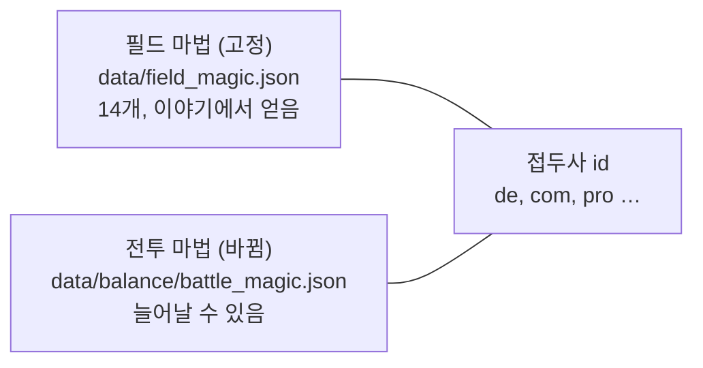

# 고정되는 것과 고쳐 나갈 것

레벨 테스트를 하며 전투 수치와 적은 계속 바뀐다. 이야기는 한번 정하면 잘 바꾸지 않는다. 그래서 둘을 떼어 둔다.

## 1. 나누는 기준

| | 고정(이야기와 묶임) | 고쳐 나감(밸런스 데이터) |
|---|---|---|
| 마법 | **필드 마법** 14개: 접두사 이름, 필드 효과, 얻는 시점 | **전투 마법**: 종류, 효과, 위력, 퀴즈 여부. 늘어날 수 있다 |
| 어근 | 어근 이름, 필드 능력, 퀘스트 | 전투 스킬의 조건과 수치 |
| 적 | 어떤 단어가 어느 스테이지에 나오는가 | 레벨, 코인, 능력치 성향, 스킬, 속성 능력, 필드 움직임 |
| 보스 | 누가 어느 스테이지 보스인가, 대사 | 레벨, 코인, 보스 능력과 수치 |
| 장비·속성 | 단어마다 유닛·부위·속성 | 속성 능력의 동작과 수치, 켜지는 개수 |
| 파일 | `data/scenes/`, `data/field_magic.json`, `locale/story.csv` | `data/balance/*.json`, `locale/system.csv`의 규칙 설명 |

## 2. 이야기에 쓰지 않는 것

- 전투 마법의 효과, 수치, 종류(순서·효과·방어·공격), 방어 마법 퀴즈 규칙
- 적·보스의 능력치, 대응 방법, 특수 능력의 구체적인 동작
- 속성 능력이 켜지는 개수나 동점 규칙 같은 장비 규칙의 숫자

이야기에서는 접두사의 **뜻**과 **필드 효과**만 말한다("pro-는 '앞으로'. 등대 빛을 앞으로 뻗게 한다"). 전투에서 무엇을 하는지는 게임 안 도움말이 알려 준다. 도움말은 마법·어근을 길게 누르면 나오는 설명이고, `data/balance`의 정의에서 만든다(4절).

예전 대본에 있던 전투 규칙 설명 장면 3개(방어 마법 퀴즈, 순서 마법, 속성 동점 규칙)는 빼고 유머 장면으로 바꿨다. 속성·4차 장비 소개 장면은 숫자 없이 "같은 무늬를 모으면 세진다" 정도만 남겼다.

## 3. 마법을 둘로 나누기



- 같은 접두사가 양쪽에 있을 수 있다. 플레이어가 필드 마법을 얻으면 같은 id의 전투 마법도 쓸 수 있게 된다.
- 전투 마법은 필드 마법 없이 따로 늘릴 수 있다. 예: 나중에 `trans-`를 전투 마법으로만 추가. 얻는 방법은 `battle_magic.json`의 `unlock`에 적는다(보스 보상, 도감 수, 레벨 등). **필드 마법은 늘리지 않는다.** 그래서 이야기는 바뀌지 않는다.
- 방어 마법 퀴즈에 쓰는 조합 어근이 늘어나도(장착 어근 증가) 이야기와 상관없다.

## 4. 고치기 쉬운 데이터 구조

### 전투 마법 `data/balance/battle_magic.json`

```json
{ "id": "com", "prefix": "com-", "kind": "defense", "class": "ShareDamage",
  "params": { "share": 0.333, "taken_by_others": 0.5 }, "quiz": "combo" }
```

- `class`는 동작(코드의 클래스 이름), `params`는 수치. 수치만 바꿀 때는 `params`만 고친다.
- 수식 문자열(`"2*P"`, `"ceil(P/2)"`)을 허용한다. P는 마법 위력(`power` 식).
- 설명 문장은 `locale/system.csv`의 `sys.magic.<id>.desc`에 둔다. 문장 안에 `{damage}` 같은 자리를 두고, 화면에서 `params`의 실제 값으로 채운다. 그래서 수치를 바꿔도 설명이 저절로 맞는다.

### 적 `data/balance/enemy.json` 외

적 능력치는 층을 쌓아 정한다. 위층에서 정한 것을 아래층이 덮어쓴다.

| 층 | 파일 | 정하는 것 | 레벨 테스트에서 고치는 때 |
|---|---|---|---|
| 0. 유닛 공식·장비 | `unit.json`, `gear.json` | 레벨당 능력치, 코인 값, 마법 위력, 장비 식(플레이어·적 공통) | 게임 전체 성장 속도가 이상할 때(드물게) |
| 1. 스테이지 곡선 | `enemy.json` `stage_curve` | 스테이지별 기준 레벨, 코인 수 | 스테이지 전체가 쉽거나 어려울 때 |
| 2. 빈도 보정 | `enemy.json` `frequency_level_bonus` | 드문 단어일수록 레벨 + | 희귀 단어만 튈 때 |
| 3. 성향 | `enemy_tendency.json` | 계열 어근(없으면 주속성)별 공·방·체, 코인 성향, 필드 움직임 | 특정 계열·속성이 튈 때 |
| 4. 속성 능력·팀 묶음 | `enemy.json`, `attribute_abilities.json` | 적이 쓰는 속성 능력, 시작 스테이지, 팀 묶음 조건 | 속성 상대법이 너무 강하거나 약할 때 |
| 5. 단어별 덮어쓰기 | `enemy_overrides.json` | 단어 하나의 레벨 차, 성향, 스킬, 능력 | 특정 단어 하나만 문제일 때 |

- 대응 방법(어떤 마법·어근이 잘 듣는가)은 따로 정하지 않는다. 마법·스킬·능력의 정의에서 저절로 나온다. 그래서 정의만 고치면 대응 방법도 따라 바뀐다.
- 보스는 `boss.json`. 보스 능력도 `class` + `params` 꼴이다.

## 5. 레벨 테스트 흐름

1. `tools/balance/`의 시뮬레이터(`sim10.py`, `final.py`)로 스테이지별 승률을 뽑는다. 시뮬레이터는 게임의 규칙 층 코드를 그대로 쓴다([architecture.md](../dev/architecture.md) 10절).
2. 목표(필드 70~80%, 보스는 그보다 조금 낮게)에서 벗어난 스테이지를 찾는다.
3. 4절 표의 위층부터 고친다. 스테이지 전체 → 계열·속성 → 단어 하나 순서.
4. 고친 파일과 이유를 `docs/design/tuning-log.md`(테스트를 시작하면 만든다)에 한 줄씩 남긴다.
5. 이야기 파일(`data/scenes`, `locale/story.csv`)은 건드리지 않는다. 건드려야 한다면 1절의 경계가 잘못된 것이니 설계를 먼저 고친다.
