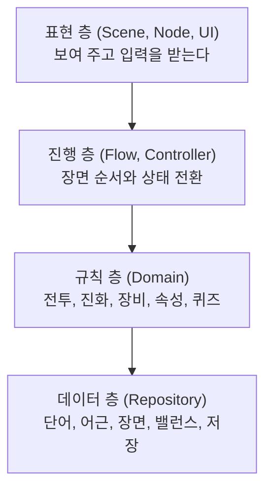
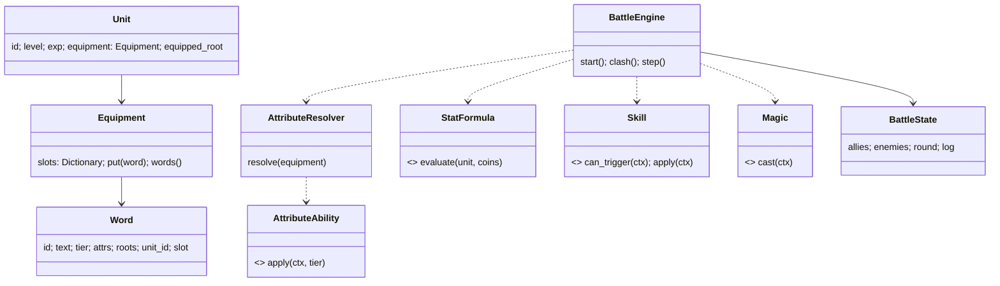

# 코드 구조와 객체지향 규칙

이 게임은 만들면서 규칙이 자주 바뀐다. 코인 식, 속성 능력, 진화 규칙, 스테이지 수 같은 큰 개념도 바뀔 수 있다. 그래서 코드는 **바뀌는 부분을 객체 하나에 가두고, 나머지 코드는 그 객체의 겉모양(인터페이스)만 알게** 짠다. 이 문서는 Godot 4(GDScript) 기준이다.

## 1. 목표

- **규칙을 바꿀 때 고치는 파일이 적다.** 예: 속성 능력 하나를 바꾸면 그 능력 클래스 하나와 데이터 한 줄만 바뀐다.
- **화면 없이 규칙을 시험할 수 있다.** 전투·진화·배정 같은 규칙은 노드(Node) 없이 돌아가는 순수 객체로 만들고 단위 테스트로 확인한다.
- **숫자와 문장은 코드에 없다.** 수치는 밸런스 데이터에, 문장은 `locale/`에 둔다.

## 2. 층 나누기



| 층 | 하는 일 | 무엇으로 만드나 | 하지 않는 일 |
|---|---|---|---|
| 데이터 | JSON·CSV를 읽어 객체로 바꾼다. 저장·불러오기 | `RefCounted` 클래스(`WordRepository`, `SaveStore`) | 규칙 계산 |
| 규칙 | 게임 규칙 계산. 상태를 받아 결과를 돌려준다 | `RefCounted` 클래스, 순수 함수 | 노드·화면·입력·`tr()` 호출 |
| 진행 | 지금 무슨 장면인지, 다음은 무엇인지. 규칙 층을 불러 쓴다 | 상태 기계(`GameFlow`, `BattleFlow`) | 그리기 |
| 표현 | 그리기, 애니메이션, 입력. 진행 층에 "이 버튼 눌림"만 알린다 | Scene(.tscn) + 스크립트 | 규칙 계산 |

**의존 방향은 위에서 아래로만.** 규칙 층은 표현 층을 모른다. 규칙 결과를 화면에 알릴 때는 시그널이나 이벤트 객체를 돌려준다.

## 3. 바뀔 가능성이 큰 곳과 그 경계

설계 문서에서 이미 여러 번 바뀐 곳은 처음부터 갈아 끼울 수 있게 만든다.

| 바뀌는 것 | 경계(인터페이스) | 구현 예 | 바꿀 때 |
|---|---|---|---|
| 코인 식, 능력치 공식 | `StatFormula.evaluate(unit, coins) -> Stats` | `CoinStatFormula`, `FixedStatFormula` | 새 공식 클래스 + 밸런스 데이터 |
| 스킬 65개 | `Skill.can_trigger(ctx)`, `Skill.apply(ctx)` | `ShieldSkill`, `CoinFlipSkill` | 스킬 클래스 하나 |
| 마법 14개 | `Magic.cast(ctx)` + 종류(순서·효과·방어·공격) | `OrderMagic`, `DefenseMagic` | 마법 클래스 하나 |
| 속성 능력 20개 | `AttributeAbility.apply(ctx, tier)`, tier = 약·강 | `LifeRegen`, `WindFirstStrike` | 능력 클래스 하나 |
| 켜지는 속성 고르기 | `AttributeResolver.resolve(equipment) -> {attr, tier}` | 주·보조 1점, 동점이면 무기→신발 | 해결자 하나 |
| 진화 규칙 | `EvolutionRule.can_evolve`, `quiz_words`, `on_fail` | 트리 기반, 재포획 목표 | 규칙 하나 |
| 퀴즈 형식 | `QuizBuilder.build(words) -> Quiz` | 4지선다, 조합 뜻 고르기 | 빌더 하나 |
| 보스 능력 | `BossAbility` (스킬과 같은 꼴) | `DefectCoinLock` | 클래스 하나 |
| 스테이지 구성 | 데이터(`stages.json`)만 | — | 데이터만 |
| 미니게임 | `Minigame` 장면 + `MinigameResult` | 마을마다 하나 | 장면 하나 |

이 경계들은 **전략(Strategy) 패턴**이다. 규칙 층은 "지금 쓸 공식 객체"를 받아 부를 뿐, 어떤 공식인지 모른다. 어떤 객체를 쓸지는 데이터가 정한다(5절).

## 4. 클래스 그림 (규칙 층 핵심)



- **상속보다 조합.** `Unit`은 "공격형 유닛"처럼 갈래로 상속하지 않는다. 성향은 `StatFormula`와 데이터로 붙인다. 상속은 `Skill`, `Magic`처럼 "같은 꼴의 여러 구현"에만 쓴다(얕게, 한 단계).
- **값 객체.** `Stats`, `CoinResult`, `QuizAnswer`처럼 계산 결과는 바꿀 수 없는 작은 객체로 돌려준다. 여러 곳에서 고치지 않게 한다.
- **전투 맥락(ctx).** 스킬·마법·능력은 `BattleContext` 하나만 받는다. 새 효과가 새 정보를 필요로 하면 `BattleContext`에 필드를 더하고, 효과 객체들의 함수 꼴은 그대로 둔다.

## 5. 데이터가 객체를 고른다

효과의 종류와 수치는 데이터에 쓰고, 코드는 등록부(registry)에서 이름으로 클래스를 찾는다.

```json
{ "id": "attr.life", "class": "LifeRegen", "weak": { "heal": 1 }, "strong": { "heal": 2 } }
```

```gdscript
# registry.gd — 이름으로 효과 클래스를 찾는다
class_name EffectRegistry
const CLASSES := {
    "LifeRegen": preload("res://src/domain/attributes/life_regen.gd"),
    "WindFirstStrike": preload("res://src/domain/attributes/wind_first_strike.gd"),
}
static func make(def: Dictionary) -> AttributeAbility:
    var ability: AttributeAbility = CLASSES[def["class"]].new()
    ability.configure(def)   # 수치는 데이터에서
    return ability
```

```gdscript
# attribute_ability.gd — 모든 속성 능력의 겉모양
class_name AttributeAbility extends RefCounted
func configure(def: Dictionary) -> void: pass
func apply(ctx: BattleContext, tier: int) -> void: pass   # tier: 1=약, 2=강
```

```gdscript
# life_regen.gd — 생명: 라운드마다 체력 회복
class_name LifeRegen extends AttributeAbility
var _heal := {}
func configure(def: Dictionary) -> void:
    _heal = { 1: def["weak"]["heal"], 2: def["strong"]["heal"] }
func apply(ctx: BattleContext, tier: int) -> void:
    ctx.on_round_end(func(unit): unit.heal(_heal[tier]))
```

수치를 바꿀 때는 JSON만, 능력의 동작을 바꿀 때는 그 클래스 하나만 고친다.

## 6. 폴더

```
src/
  data/        # Repository: 단어, 어근, 장면, 밸런스, 저장
  domain/      # 규칙: battle/, evolution/, equipment/, attributes/, skills/, magic/, quiz/
  flow/        # 상태 기계: game_flow, battle_flow, town_flow, cutscene_flow
  ui/          # 장면과 화면 스크립트
  events/      # 이벤트 버스, 이벤트 객체
data/
  balance/     # 밸런스 수치(JSON): 코인, 능력치, 속성 능력, 스킬, 마법, 보스
  scenes/      # 이야기 장면(이미 있음)
locale/        # 문장(이미 있음)
tests/         # 규칙 층 단위 테스트
```

## 7. 장면 간 연락: 이벤트 버스

표현 층끼리 서로 직접 부르지 않는다. 전역 `EventBus`(autoload) 하나를 두고 시그널로 알린다.

```gdscript
# event_bus.gd (autoload)
signal word_captured(word_id: String)
signal evolution_failed(target_word_id: String)
signal stage_cleared(stage: int)
```

예: 진화가 실패하면 진화 화면이 `evolution_failed`를 보내고, 필드 화면은 그걸 받아 재포획 목표 표식을 띄운다. 두 화면은 서로를 모른다.

전역 객체(autoload)는 `EventBus`, `GameData`(저장 상태), `Locale` 세 개까지만 둔다. 그 밖의 객체는 만들 때 필요한 것을 넘겨받는다(의존성 주입).

## 8. 상태 기계

게임 흐름(필드 → 조우 → 퀴즈 → 전투 준비 → 격돌 → 결과)은 상태 객체로 나눈다. 상태마다 `enter()`, `handle(event)`, `exit()`가 있다. 흐름이 바뀌면(예: 퀴즈를 전투 뒤로 옮김) 상태 순서만 바꾼다.

```gdscript
class_name BattleFlow extends RefCounted
var _state: FlowState
func go(next: FlowState) -> void:
    if _state: _state.exit()
    _state = next
    _state.enter()
```

## 9. 문장과 수치

- 화면에 나오는 모든 글자는 `tr("키")`로 꺼낸다. 키 규칙은 [i18n.md](../i18n.md).
- `tr()`은 표현 층에서만 부른다. 규칙 층은 키나 이벤트 객체만 돌려준다.
- 코드에 수치를 직접 쓰지 않는다(`3`, `0.5` 같은 밸런스 값). `data/balance/`에서 읽는다. 예외: 0, 1, 화면 배치용 픽셀.

## 10. 테스트

- 규칙 층은 단위 테스트를 단다(GUT 같은 Godot 테스트 도구). 전투는 코인 결과를 정해 넣을 수 있게 `CoinSource`를 주입한다(테스트에서는 정해진 앞/뒤를 돌려주는 가짜).
- 규칙이 바뀌면 테스트부터 고친다. 테스트 이름에 설계 문서의 규칙을 그대로 쓴다(예: `test_tie_breaks_by_weapon_primary_attr`).
- 밸런스 시뮬레이션은 같은 규칙 층 코드를 재사용한다. 따로 계산기를 만들지 않는다.

## 11. 큰 개념이 바뀔 때

1. 설계 문서(`docs/design/`)를 먼저 고친다.
2. 바뀌는 개념이 3절 표의 어느 경계에 속하는지 찾는다. 없으면 새 경계(인터페이스)를 만들고 표에 더한다.
3. 옛 구현은 지우지 말고 데이터에서 새 구현으로 바꿔 끼운 뒤, 테스트가 통과하면 옛 구현을 지운다.
4. 저장 파일 형식이 바뀌면 `SaveStore`에 버전 번호와 변환 함수를 더한다(옛 저장을 새 형식으로).

## 12. 이름과 꼴

- 파일은 `snake_case.gd`, 클래스는 `class_name PascalCase`, 함수·변수는 `snake_case`, 비공개는 `_` 접두.
- 모든 함수에 타입을 적는다(`func clash(a: Unit, b: Unit) -> ClashResult`).
- 한 파일 한 클래스. 300줄을 넘으면 나눌 곳을 찾는다.
- 주석은 "왜"를 쓴다. 규칙의 출처(설계 문서 절)를 적어 둔다.
